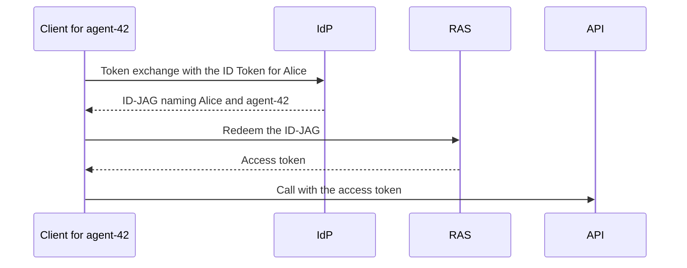
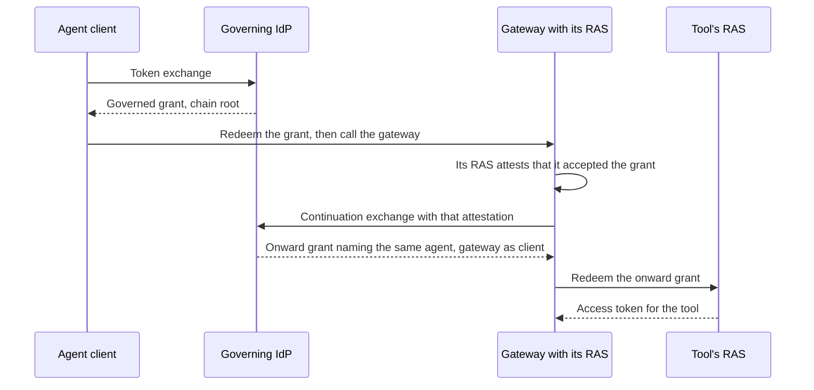
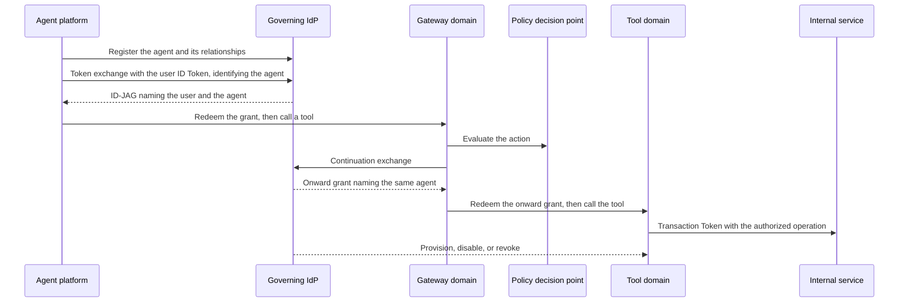
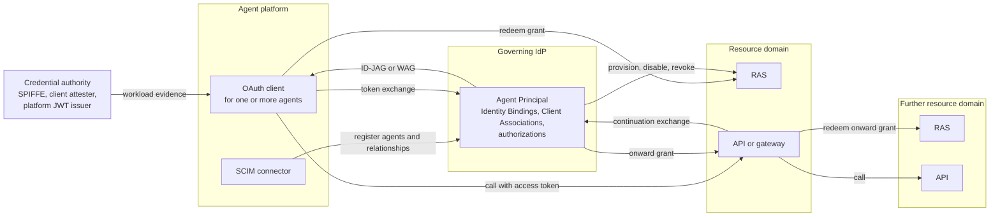

# Governed Agent Profiles: Architecture Overview

This overview is non-normative. A reader should finish it able to
explain the system, choose a deployment model, and understand its
guarantees and limits. The [playbook for identity teams](PLAYBOOK.md)
covers operating a deployment, the [implementer's
guide](IMPLEMENTERS-GUIDE.md) covers configuring and implementing it,
and the drafts define every requirement and govern wherever this
overview differs from them.

One example runs throughout: the enterprise identity provider (IdP)
`https://idp.example/` governs the agent `agent-42`, which acts for the
user Alice through the OAuth client `analysis-client` against the
resource domain whose authorization server (RAS) is
`https://ras.example/` and whose tenant is `acme-data`.

* [The system in one page](#the-system-in-one-page)
* [Identity, authority, and responsibility](#identity-authority-and-responsibility)
* [Trust between parties](#trust-between-parties)
* [Access flows and deployment variants](#access-flows-and-deployment-variants)
* [Changes, failures, and recovery](#changes-failures-and-recovery)
* [Optional integrations and boundaries](#optional-integrations-and-boundaries)
* [Specification map and glossary](#specification-map-and-glossary)

## The system in one page

### The problem

Enterprises run agents on platforms they do not operate. Each platform
issues its own identity for the workload it runs, and that identity is
not the principal the enterprise governs. The enterprise needs to
recognize, authorize, and audit each agent as one principal across
changes in platforms, workloads, and credentials.

The common workaround is one shared OAuth client per platform
integration. Every agent behind it looks identical to the resource
server, so actions cannot be attributed and revocation becomes all or
nothing.

### Four identities

| Identity | What it is | In the example |
|---|---|---|
| Execution identity | What a platform issues for the workload it runs, or the client's own authentication. It is evidence, not the governed principal | The dedicated client `analysis-client` authenticating to the IdP |
| Agent Principal | The agent the enterprise governs, in the IdP's namespace. It stays the same as platforms, workloads, and credentials change, and its identifier may reuse the execution identity's | (`https://idp.example/`, `agent-42`) |
| OAuth client | The software that requests grants and tokens. Its identifier never stands in for the agent | `analysis-client` at the IdP; `analysis-api` at the RAS |
| User | The person a delegated agent acts for, resolved from the user's own sign-in | Alice, `alice-ras` in the grant, `user-108` at the resource |

`analysis-client` and `analysis-api` are the same client's registrations
at the IdP and at the RAS. The IdP derives the grant's `client_id` from
a configured association between the two, never from the client's
request. A client that uses one identifier at both servers, such as a
Client ID Metadata Document URL, needs no mapping.

### How it works

The agent's OAuth client authenticates to the enterprise IdP and
receives a grant naming the governed agent. It exchanges that grant at
the resource domain's RAS for an access token,
which it presents to the API:



The IdP resolves the client or workload identity to the Agent Principal
and carries that principal in one of two peer grants, chosen by the
acting relationship. An implementation claims one or both.

| The agent acts | Grant | The resource domain sees |
|---|---|---|
| For a user | ID-JAG | The user as subject and the agent as actor in `act` |
| For itself | Workload Authorization Grant (WAG) | The agent as subject |

```
Execution identity:  OAuth client analysis-client (dedicated client)
                             |  Identity Binding at the IdP
                             v
Agent Principal:     https://idp.example/   agent-42

Delegated ID-JAG for https://ras.example/ (excerpt):
  "sub": "alice-ras",
  "client_id": "analysis-api",
  "act": {"iss": "https://idp.example/", "sub": "agent-42"}

Self-acting WAG (excerpt):
  "iss": "https://idp.example/", "sub": "agent-42"
```

The resource domain correlates the agent with its local principal by
the exact (IdP issuer, agent identifier) pair. For delegated access,
the RAS and API also enforce the actor gate: may this agent act for
this user here?

### What is required, and what is optional

Every deployment using governed federation needs:

* identity resolution through an Identity Binding, and client authority
  through a Client Association;
* a Delegation or Agent Authorization at the IdP;
* the grant, and its redemption at the resource domain's RAS, which
  correlates the agent with a local principal; and
* resource authorization at the RAS and the API, including the actor
  gate for delegated access.

The rest are optional mechanisms, adopted as needed: inputs beyond the
dedicated client and the platform JWT, SCIM administration of the
relationships, lifecycle propagation into resource domains, gateway
continuation, an external policy decision point, and Transaction Tokens
inside a resource domain.

[Platform-hosted agents](#platform-hosted-agents) can use registration
and lifecycle governance without federation; they need no Identity
Binding, Client Association, or IdP-issued grant until they federate.

## Identity, authority, and responsibility

Five parties take part, each owning its own decisions:

| Party | Role |
|---|---|
| Agent platform | Runs agents. Implements the OAuth client that obtains access for them, and a SCIM connector that registers them at the IdP |
| Credential authority | Issues the workload evidence the IdP can resolve: SPIFFE, a client attester, or the platform's own JWTs |
| Governing IdP | Holds each Agent Principal and the relationships that govern it, and issues grants naming it |
| Resource domain | Its RAS redeems grants and issues access tokens; its API enforces them |
| Gateway | An API that continues an agent's request to a resource in another domain |

The IdP holds the relationships. Each answers one question, and none
implies another:

| Relationship | Question | Defined in |
|---|---|---|
| Identity Binding | Which governed agent does this credential identify? | The core; administered with SCIM management |
| Client Association | May this OAuth client use that agent's identity? | The core; administered with SCIM management |
| Delegation Authorization | May the agent act for this user, with what authority? | The core |
| Agent Authorization | What may the agent access on its own behalf? | The core |
| Continuation Association | May this gateway continue the agent's chains? | Continuation profile |

Four rules follow:

* **Resolving an identity does not authorize its use.** An Identity
  Binding says which agent a credential represents. A separate Client
  Association says whether a client may exercise that agent. In the
  [delegated flow](#delegated-access), disabling the association leaves
  `agent-42` resolvable but refuses the grant.
* **Attribution is not delegation authority.** In delegated access, the
  user is the subject and the agent the actor, each resolved on its own,
  and the agent's identifier never carries the user or a session. An
  agent named in `act` acts for the user only under the IdP's delegation
  decision and the resource domain's actor gate. Self-acting access has
  no user: the agent is the subject.
* **Authority stays out of identifiers.** Encoding a domain, an intent,
  or a trust realm in a workload identifier would make every change of
  scope a rename. Authority lives in separate authorizations, so the
  Agent Principal stays the same as its authority changes.
* **Each boundary keeps its own decision.** The IdP owns identity and
  the grant decision; the resource domain owns resource authority. The
  RAS decides anew within the grant, a Local Suspension in a resource
  domain cannot be cleared from upstream, and no central broker mints
  access for another domain. Being known is not being authorized.

Facts cross each boundary only by contract, which states what is
preserved, what is translated, and what is decided anew. The treatment
of each boundary follows
[Continuity Is Not One Thing](https://notes.karlmcguinness.com/notes/continuity-is-not-one-thing/).

### Issuers, tenants, and executions

An Agent Principal is the pair of its IdP's issuer and its identifier,
such as (`https://idp.example/`, `agent-42`). The pair keeps identities
from colliding:

* **Equal identifiers from different IdPs are different agents.** The
  RAS interprets an agent identifier only in its issuer's context and
  never keys authorization on a bare subject. A resource domain served
  by several IdPs keeps the issuer with each record and never merges
  records on equal identifiers.
* **Tenants scope authority, not identity.** The Governance Tenant is
  where the IdP administers the agent; the Target Tenant, such as
  `acme-data`, is where it exercises authority. Neither is part of the
  agent's identity. The RAS correlates the pair within the Target
  Tenant, and a token for one tenant is rejected in another.
* **A new governing authority means a new agent.** Moving an agent to a
  Governance Tenant under a different administrative authority gives it
  a new identifier. Its delegations do not carry forward, and resource
  domains do not re-key their links to the new identifier.

Executions share a principal by default. Replicas, restarts, sessions,
migrations, and rotated credentials run as the same Agent Principal
through its Identity Bindings, and none of them creates or increases
its authority. An execution needs its own Agent Principal only when it
needs separate authorization, delegation, attribution, resource
correlation, or disablement, even if it shares a runtime, client, or
credential with another agent.

### Sub-agents and orchestrators

An orchestrator agent often starts sub-agents for parts of a task. The
same rule decides their identity ("Governance Boundary and Execution
Independence" in the core):

| The sub-agent | Identity | Authority |
|---|---|---|
| Works entirely within its parent's authority and is attributed to it | The parent's Agent Principal; the sub-agent is one more execution of it | The parent's grants, reused only within the same agent, user, tenant, and authority |
| Needs its own authorization, delegation, attribution, correlation, or disablement | Its own Agent Principal | Its own Client Association and Delegation or Agent Authorization; the parent's authority does not pass to it |
| Acts for the orchestrator, as one agent delegating to another | Out of scope: multi-agent delegation chains are not defined | |

These profiles define no automatic inheritance or cascading withdrawal
between agents. A deployment can explicitly constrain a sub-agent by its
orchestrator's current authority; otherwise, each authorization is
narrowed or withdrawn separately. The implementer's guide covers
[the patterns](IMPLEMENTERS-GUIDE.md#sub-agents-and-orchestrators).

## Trust between parties

Every arrow in the flows rests on an agreement configured at both ends
before the first request. The drafts require each agreement, not a
format for it; the implementer's guide lists the items under
[Federation configuration](IMPLEMENTERS-GUIDE.md#federation-configuration).
None of them comes from a request: request parameters, presented
credentials, and discovered metadata never create or widen one.

| Boundary | What the parties agree | What goes wrong without it |
|---|---|---|
| Platform → IdP | The connector, its Governance Tenant, and its Provisioning Domain; the credential authorities, source identities, and OAuth clients it may use. Registering an agent, binding an identity to it, and authorizing a client to use it are separate permissions, and permission to disable never implies permission to enable | Binding and association writes can let an identity act as an enterprise agent. The IdP therefore limits each connector to approved credential authorities, source identities, clients, and agents, and checks its authority over both ends of every relationship |
| Credential authority → IdP | Each trusted issuer or trust domain, with its approved keys, algorithms, and time limits, and the credential class that tells its workload credentials apart from its other tokens. Identity Bindings name an exact issuer and subject | Evidence for which the IdP cannot select exactly one configured class fails with `invalid_request`; evidence rejected under the selected class fails with `invalid_grant`. Neither falls back to another class. Without a class rule, a user or management token from the same issuer could pass as workload evidence |
| IdP → RAS | That the RAS accepts this IdP's ID-JAGs or WAGs and its assertion of the agent namespace; the client registration association that supplies each grant's `client_id`; the Target Tenant for each resource, and whether the IdP may assert local account identifiers there; and the minimum profile for each client, trust relationship, and resource | Without a client registration association, the IdP refuses with `invalid_target`. A grant from an untrusted issuer or namespace is rejected at redemption. Each server enforces its own minimum profile, and no failure is retried at a lower one |
| RAS → API | The resource's minimum profile; how each token's population, delegated or self-acting, is established (separate client registrations, audiences, or issuers, or authenticated introspection context); the tenant-specific audience; the access-token protection; and whether the API introspects or validates offline | The API rejects a token whose applicability is ambiguous, and a delegated-population token without `act`, with HTTP 401 `invalid_token`. The validation mode decides how soon a revocation at the RAS reaches the API |
| Lifecycle sender → receiver | A Provisioning Domain naming one governing IdP issuer and one Target Tenant, with the connectors authorized for it. For events: the stream's transmitter, audience, and source service, and the ID-JAG issuer whose grants it may revoke. The issuer comes from this configuration, never from a provisioned attribute | A revocation naming another issuer's grant is rejected, and a transport failure or partial result is never read as a deletion. The receiver's Local Suspensions and resource permissions stay its own: upstream activation cannot clear them |
| Gateway's RAS → IdP | The IdP trusts the gateway's RAS, or an issuer trusted for it, as Continuation Assertion Issuer for its hops, with the same canonical identity for the gateway configured at both. A Continuation Association permits the gateway to continue the agent's chains in one acting relationship | A gateway without a Continuation Association is refused with `unauthorized_client` and does not fall back to its own authority. The assertion shows only that the RAS accepted the hop; the IdP's governance checks still decide |

Adding a resource domain, a credential issuer, or a gateway therefore
means adding its row at both ends.

## Access flows and deployment variants

Every deployment starts from two flows: an agent acting for a user, and
an agent acting for itself. Both use the running example, with the
identifiers of the core's [walkthrough][core-walkthrough]. The
implementer's guide's
[primer](IMPLEMENTERS-GUIDE.md#primer-two-grants-one-identity-model)
walks both message by message. Four variants follow, each in the same
shape: when to use it, its prerequisites, what changes, and its
limitations. Domains are always crossed with grants: an ID-JAG or WAG, or
continuation through a gateway, so the target domain validates a grant
from the IdP it already trusts. Tokens bound to one trust domain, such
as Transaction Tokens, stay inside it.

### Delegated access

`agent-42` reads the file `report-7` in `acme-data` for Alice. Each
party decides one question, from facts it can verify itself:

| Step | Party | Decides | From |
|---|---|---|---|
| Sign-in | IdP | Who the user is | Alice's sign-in, and an ID Token whose audience is `analysis-client` |
| Resolution | IdP | Which agent the client is | `analysis-client`'s `private_key_jwt` authentication, which the Identity Binding maps to `agent-42` |
| Client authority | IdP | Whether this client may use that agent for delegated access | The Client Association |
| Delegation | IdP | Whether `agent-42` may act for Alice at this resource, with `files.read` | Alice's Delegation Authorization |
| Grant | IdP | What the RAS receives | ID-JAG `grant-1`: `sub` `alice-ras`, `act` (`https://idp.example/`, `agent-42`), `client_id` `analysis-api`, bound to the client's DPoP key |
| Redemption | RAS | Whether to issue access, and how much | The IdP's signature and its trust for the `act` namespace; the client's RAS authentication and key proof; its own records for `agent-42` and Alice; the actor gate and its own policy. The grant sets a ceiling; it does not oblige the RAS to issue |
| Access | API | Whether this operation is allowed | Access token `access-1` and its proof; the tenant in its audience; Alice's permissions; the actor gate |

Three properties follow from that division:

* **The agent is named once and checked three times.** The IdP resolves
  it, the RAS correlates the exact (issuer, agent) pair with its own
  record, and the API applies the actor gate.
* **Resolution and authorization fail separately.** With the Client
  Association disabled, the Identity Binding still resolves `agent-42`,
  but the IdP refuses the grant with `actor_unauthorized`, and nothing
  reaches the RAS.
* **The client never stands in for the agent.** `analysis-api` is the
  client at the RAS, and the access token keeps `agent-42` in `act`, so
  agents that share a client remain distinct actors.

The walkthrough's RAS issues no refresh token. When `access-1` expires,
the client obtains a new ID-JAG, and the IdP decides again. The
playbook's [delegated recipe](PLAYBOOK.md#recipe-delegated-access-to-a-saas-application)
deploys this flow, tests it, and stops and restores it.

### Self-acting access

`agent-42` runs a job on its own authority, with no user. Resolution is
the same: one binding, one Agent Principal. The authority is different:

| Step | Delegated | Self-acting |
|---|---|---|
| The client presents | Alice's ID Token as the subject token | Its own authentication JWT, repeated as the subject token |
| The IdP checks | The Client Association for delegated issuance, and Alice's Delegation Authorization | The Client Association for self-acting issuance, and the agent's Agent Authorization |
| The grant | ID-JAG: the user as `sub`, the agent in `act` | WAG `wag-1`: `agent-42` as `sub`, no `act` |
| The RAS | Resolves Alice and the agent, and applies the actor gate | Correlates `agent-42` to its local principal `service-principal-42`, and applies that principal's policy |
| The access token | `sub` `user-108`, `act` `agent-42` | `sub` `service-principal-42`, no `act`, and never a refresh token |
| The API | Alice's permissions and the actor gate | The agent's own permissions, with no actor gate |

Neither authorization implies the other. Withdrawing Alice's delegation
leaves the agent's own access unchanged, and withdrawing the Agent
Authorization leaves Alice's delegation in place. Where both flows
reach one API, the API tells their tokens apart from trusted
configuration, such as a separate client registration or audience, or
from authenticated issuance context. It never relies on the absence of
`act`, which would let a malformed delegated token pass as self-acting.
The core's [self-acting variant][core-wag-example] shows the messages,
and the playbook's
[self-acting recipe](PLAYBOOK.md#recipe-self-acting-access) deploys and
tests the flow.

### Shared platform clients

* **When to use:** a platform runs many agents behind one OAuth client,
  such as its single sign-on client, instead of registering a client per
  agent.
* **Prerequisites:** the IdP trusts the platform as a credential issuer
  for that client, with its issuer, credential class, keys, algorithms,
  time limits, and accepted audiences configured together with the
  client. Each agent has an Identity Binding naming the exact issuer and
  subject of its workload, and a Client Association for the shared
  client.
* **What changes:** the client authenticates as itself and presents the
  platform's existing JWT for the agent's workload: as the actor token
  for delegated access, or as the subject token for self-acting access.
  The RAS and API see no difference; the grant names the agent, and
  `client_id` is the shared client's registration.
* **Limitations:** the client's authentication cannot tell its agents
  apart, so a token it holds for one agent is never reused for another,
  even with a matching scope. A platform JWT that fails validation is
  rejected with `invalid_grant` and is not retried under another
  credential class. The core's [AWS example][core-aws-example] shows the
  input.

### Continuation through gateways

* **When to use:** an agent reaches tools through a gateway, such as a
  Model Context Protocol (MCP) gateway, that selects a tool at request
  time and calls it in another resource domain. The gateway holds
  neither the user's credential nor the agent's, and calling the tool as
  itself would make every agent behind it look the same: the
  shared-client problem again.
* **Prerequisites:** the continuation profile at the IdP, the gateway,
  and the gateway's RAS; trust in that RAS as Continuation Assertion
  Issuer; a Continuation Association for the gateway; a user delegation,
  or the agent's own authorization, that permits continuation through
  other clients; and DPoP at the target RAS's token endpoint.
* **What changes:** the gateway continues the agent's chain instead of
  calling as itself.



The onward grant names the same Agent Principal and, for delegated
access, the same user. A RAS and API that implement the core accept it
unchanged, because every onward grant is bound to the gateway's key.
The gateway is the grant's client, never an added actor; a separate
`continuation_via` claim lists the gateways on the path.

* **Limitations:** the API sees `continuation_via` only where the
  target RAS supports path disclosure. A chain ends when its anchor
  ends, such as the user's IdP session, and on governance events:
  disabling the agent or user, or withdrawing the root binding,
  association, credential, or authorization. Self-acting chains anchor
  to an agent session that only the agent's own authentication keeps
  active, so a gateway cannot keep a stopped agent's chains alive.
  Continuation also stops once the source hop's continuation window
  passes, even while the agent's access token at the gateway is still
  accepted.

### Scheduled work

* **When to use:** an agent works for a user after the user signs out,
  such as preparing a daily report.
* **Prerequisites:** an IdP that claims grant-anchored continuation and
  accepts refresh-token subjects from the agent's client; a refresh
  token for the user whose grant carries the user's Delegation
  Authorization; a continuation-aware RAS at the agent's operator that
  holds the task record; and a Continuation Association for the agent's
  client.
* **What changes:** while the user is signed in, the client uses the
  refresh token once to root a chain anchored to its grant. Each run
  continues from the task record and obtains a new ID-JAG for the
  target, with no retained user credential. The target RAS processes
  that grant as in the delegated flow.
* **Limitations:** delegated access only. Withdrawing the user's
  delegation, or revoking the refresh-token grant, ends the chain, and
  the next run fails with `invalid_continuation`. The continuation
  profile's [scheduled variant][continuation-scheduled] shows the
  messages.

### Platform-hosted agents

* **When to use:** a platform, such as a data or application platform,
  hosts agents for a customer that use only the platform's own tools and
  resources, and must keep running when the IdP is unavailable. The
  enterprise still wants them in one inventory, under one governance
  decision, and visible in its monitoring.
* **Prerequisites:** the SCIM management profile for registration, and
  the platform as the lifecycle Receiver for its own agents.
* **What changes:** the IdP stays out of the platform's runtime path.
  * **Register, don't federate.** The platform's connector registers
    each hosted agent at the IdP as an Agent with no Identity Binding or
    Client Association. The agent is visible and governed but cannot
    obtain an IdP grant.
  * **Split authority.** The platform owns the agent's existence,
    description, and deletion. The IdP owns the governance decision,
    `active`, and the connector cannot re-enable an agent the IdP
    disabled.
  * **Apply governance locally.** When the IdP disables an agent, the
    platform denies new authorization and revokes the agent's existing
    authorization in its own system. Its own suspension is a Local
    Suspension the IdP cannot clear.
  * **Signal both ways.** The platform sends WISE credential and posture
    events and CAEP session events about its agents to the IdP, and the
    IdP can send CAEP risk changes back. Events inform policy; they do
    not change administrative state.
  * **One correlation key.** The issuer-qualified Agent Principal
    identifier appears in SCIM, in events, and in the platform's audit
    records next to the platform's own identifier.
* **Limitations:** the platform authorizes from locally applied state,
  so an unreachable IdP neither disables nor re-enables its agents; a
  bound on stale state needs a revalidation policy. To reach a resource
  beyond the platform, an administrator adds an Identity Binding and a
  Client Association for the selected acting relationship to the same
  Agent. Its identifier and governance history carry over.

The implementer's guide
[follows one agent](IMPLEMENTERS-GUIDE.md#platform-hosted-agents) from
registration through third-party access and retirement, and the
lifecycle draft's [platform-hosted example][lifecycle-example] shows its
risk signals, disablement, and re-enablement.

### One deployment, end to end

This advanced example combines the required parts with several optional
mechanisms: SCIM registration, a gateway, a policy decision point,
continuation, Transaction Tokens inside the tool's domain, and lifecycle
propagation. The required parts are the ones listed under [What is
required](#what-is-required-and-what-is-optional): identity resolution,
client authority, authorization, the grant and its redemption, and
resource authorization at the RAS and the API.



1. **Register.** The platform's connector registers the agent and its
   relationships at the IdP (SCIM management).
2. **Resolve and grant.** The agent's client presents the user's ID
   Token as the subject token and identifies the agent through its
   client authentication or workload evidence. The IdP resolves the
   user and the Agent Principal, checks the Client Association and the
   user's Delegation Authorization, and issues an ID-JAG, DPoP-bound in
   the bound profile (the core).
3. **Access.** The client redeems the grant at the gateway's RAS and
   calls the gateway, which enforces the user's authority and the actor
   gate and can ask a PDP about each action
   ([AuthZEN](#authorization-decisions-with-authzen)).
4. **Continue.** For a tool in another domain, the gateway continues the
   agent's chain: its RAS attests the hop, and the IdP issues an onward
   grant naming the same agent, with the gateway as client
   ([continuation](#continuation-through-gateways)).
5. **Propagate.** Inside the tool's domain, a Transaction Token carries
   the user, the agent, the client, the path, and the authorized
   operation through the internal call chain. Internal services enforce
   those bounds, and the token is never accepted outside that domain.
6. **Govern.** Changes at the IdP or in a resource domain take effect
   as [Changes, failures, and recovery](#changes-failures-and-recovery)
   describes. Transaction Tokens inside the tool's domain end by their
   own validation and expiry rules, and risk signals feed issuance and
   per-action decisions.

The implementer's guide covers
[Transaction Tokens inside a resource domain](IMPLEMENTERS-GUIDE.md#transaction-tokens-inside-a-resource-domain)
and [risk signals](IMPLEMENTERS-GUIDE.md#risk-signals).

## Changes, failures, and recovery

Identity and authority have separate owners, checks, and lifetimes, so
each change ends something different. A change stops new authorization
at once at the component that makes the decision. Anywhere else, it
takes effect only when that component applies it, and authority already
issued runs until its own revocation or expiry.

| Change | New authorization stops | Already issued | Restored by |
|---|---|---|---|
| Disable an Identity Binding | At the IdP, through that binding; other bindings continue. Chains rooted through it end | Grants and RAS tokens, until revoked or expired | Re-enabling it; ended chains stay ended |
| Remove a Client Association | At the IdP, for that client's use of the binding. Chains rooted through it end | Grants and RAS tokens, until revoked or expired | Restoring it; ended chains stay ended |
| Withdraw a user's delegation, or an Agent Authorization, as a whole | At the IdP, for that authorization; chains rooted under it end | RAS authorization, until revoked or its absolute expiration | Restoring it; a new root grant for ended chains |
| Narrow an authorization by removing targets or authority | New grants for what was removed are refused, and continuation to it fails with `invalid_target` or `invalid_scope`; chains continue to other targets | Tokens already issued for the removed targets, until revoked or expired | Restoring the targets or authority |
| Disable the Agent Principal | At the IdP, for every binding and client; every chain for the agent ends | Once a resource domain applies the change, redemption and refresh are denied there and the agent's sessions are revoked | Re-enabling it permits new decisions; revoked sessions and ended chains stay ended |
| Revoke one ID-JAG through the optional grant-derived revocation capability | Its redemption, at participating receivers in the target tenant | The authorization derived from it there is revoked; the agent stays enabled | A new grant; the revoked one stays unusable |
| Apply a Local Suspension | In that resource domain, regardless of upstream state | API access stops when its policy observes the change, introspection reports the token inactive, or the token expires | Only the resource owner lifting it |
| Remove a Continuation Association | That client's continuation of the agent's chains; the chains continue through other clients | Tokens already obtained, until they expire | Restoring it |

Re-enabling never restores revoked sessions. Current administrative
state cannot reveal a missed disable-and-re-enable cycle, and how
quickly an API stops accepting tokens depends on introspection, caching,
and token lifetimes. Without a bound on propagation and enforcement,
the drafts claim no finite end-to-end denial time; a deployment
documents its expected and maximum delay.

### Failures

A component that cannot reach another keeps the decisions it has
already applied, and makes no decision that needs the missing input.
The table separates continuing an authorized operation with tokens
already issued from obtaining new authority.

| Failure | Existing authorized operations | New authority | Recovery |
|---|---|---|---|
| The IdP is unavailable | Access tokens work until they expire. Where a RAS issued a refresh token under explicit policy, for delegated access only, refresh continues within its absolute expiration. Platform-hosted agents are unaffected, until any configured stale-state bound expires and new authorization is denied | No new ID-JAG, WAG, or onward grant; a self-acting agent stops when its access token expires. Where the IdP cannot confirm shared state a continuation depends on, it answers HTTP 503 and the chain does not end | New grants once the IdP is reachable; after a 503, a gateway can retry the same continuation while its assertion is unexpired |
| Lifecycle delivery is delayed or lost | The resource domain keeps its last applied state, so a disablement not yet applied there stops neither redemption, refresh, nor sessions in that domain | Decided on the last applied state, unless a revalidation policy with a maximum stale-state interval denies new authorization and refresh once that interval expires | Reconciliation retrieves current state from the source; a delayed activation notice triggers retrieval, never activation. A missed disable-and-re-enable cycle cannot be recovered from current state |
| The RAS has no record for the agent | Agents already correlated are unaffected | Redemption that depends on the missing record is denied; a WAG fails with `invalid_grant`. Where resource policy enables just-in-time correlation for that issuer and tenant, the RAS can create the record from the validated grant, applying local restrictions and policy before issuance | Provision the record, or enable just-in-time correlation. A record created just in time still needs lifecycle integration to learn of disablement |
| Introspection is unavailable at the API | A failed or timed-out check cannot authorize the request. Cached active responses stay usable within the cache policy | The RAS can still issue tokens | Requests succeed once introspection returns |
| A policy decision service is unavailable | The drafts define no behavior. The resource domain chooses to deny or to apply local policy, and neither can exceed the token's constraints | Not affected at the IdP or RAS | Decisions resume when the service returns |
| A continuation is refused | After `invalid_continuation`, the chain has ended, and the gateway rejects the agent's request with HTTP 401 `invalid_token`. After a limit or continuation-window failure (`invalid_grant`), the chain continues: the gateway fails the request with an error of its own API, and the agent's access token stays valid. The gateway never calls the tool with its own authority | No onward grant for that request | After `invalid_continuation`, a new root grant, which only the agent's client obtains; after `invalid_grant`, a different request, or a retry under a rate limit's policy |

## Optional integrations and boundaries

These integrations sit beside the required flow. None is needed to
federate an agent, and each has a different standing in the drafts, so
an example here is not a promise of interoperability:

| Integration | Standing |
|---|---|
| The companion profiles: inputs, continuation, SCIM management, OAuth client management, and lifecycle | Defined protocol behavior ([specification map](#specification-map-and-glossary)) |
| Grant-derived revocation of one ID-JAG | Optional capability with defined requirements, in the lifecycle profile |
| An external policy decision service | Optional capability with defined requirements: "Optional Policy Services" in the core |
| An AuthZEN or COAZ-MCP message mapping | Unresolved composition: the core names AuthZEN as one interface and defines no mapping ([below](#authorization-decisions-with-authzen)) |
| Transaction Tokens inside a resource domain | Illustrative deployment composition, in the [implementer's guide](IMPLEMENTERS-GUIDE.md#transaction-tokens-inside-a-resource-domain) |
| Credential brokers | Illustrative deployment composition ([below](#credential-brokers)) |
| Asynchronous approval with ARAP and AROP | Unresolved composition: an excluded composition in the core |
| Approved work, such as Mission-Bound Authorization | Outside these drafts ([below](#beyond-these-drafts)) |

### Authorization decisions with AuthZEN

These drafts decide which governed agent is acting and what authority
its grant carries. A resource domain can still ask a policy decision
point (PDP) whether to permit one operation, such as one MCP tool call,
through the OpenID AuthZEN Authorization API; COAZ-MCP maps MCP tool
calls into AuthZEN requests. The drafts define no AuthZEN mapping.

Whatever the PDP, the enforcement point keeps the user, the
issuer-qualified Agent Principal, the OAuth client, the tenant, and the
token's authority distinct, and a permit never widens the token
("Optional Policy Services" in the core). Two points need care:

* **Where the agent comes from.** COAZ-MCP's default puts the agent in
  `context.agent`, "typically `$token.?client_id`". For a governed
  delegated token, that names the platform's shared client, or in a
  further domain the gateway, instead of the agent. Delegated access
  takes the agent from the validated `act`; self-acting access uses the
  correlated local subject. The enforcement point selects the case by
  the token population configured for the resource, not by whether
  `act` is present.
* **Who supplies it.** COAZ-MCP treats attributes from a tool's declared
  mapping as untrusted and verifies only the subject identifier against
  the token. The enforcement point therefore supplies or verifies the
  agent, client, tenant, and token constraints from the validated token
  and trusted configuration; a declared mapping cannot override them.

The implementer's guide has the [integration points, use cases, and
worked requests](IMPLEMENTERS-GUIDE.md#authorization-decisions-with-authzen),
and [COORDINATION.md](COORDINATION.md) records the change proposed for
COAZ-MCP.

### Credential brokers

A credential broker, such as the Credential Broker for Agents (CB4A)
described in an individual Internet-Draft, keeps long-lived credentials
away from agents. A policy decision point approves each request, and a
separate credential delivery point mints a short-lived,
sender-constrained token from a vaulted credential. These profiles
change what a broker needs for targets that accept governed grants:

* **No vaulted credential.** The IdP issues a grant naming the agent,
  and the target's RAS issues the access token, so the broker holds no
  long-lived credential for that target, and the target sees the agent
  rather than the broker. A gateway that would otherwise inject a shared
  credential continues the agent's grant instead
  ([Continuation through gateways](#continuation-through-gateways)).
* **The broker's decisions map onto existing points.** Its policy
  decision is the IdP's issuance authorization, which can use an
  AuthZEN PDP. Its human approval tiers correspond to ARAP and AROP,
  whose composition with governed issuance the core leaves undefined.
* **Identity stays separate.** CB4A names each agent session
  `spiffe://trust-domain/agent/{user-id}/{session-id}`. A governed Agent
  Principal is stable and excludes the user and the session: the user
  travels as the subject of an ID-JAG, and a session is a chain anchor.
  A broker that federates therefore presents a stable per-agent
  identity.

Targets that accept only API keys or their own minting interfaces stay
outside these profiles. For those, the governed identity applies where
the broker decides. The implementer's guide has the
[mapping and two deployment patterns](IMPLEMENTERS-GUIDE.md#credential-brokers).

### Beyond these drafts

These drafts define agent identity and authority up to the allow or deny
decision at an action. Approved work is a third concern with its own
owner: being authorized is not being approved for this work. Work
context and per-action authorization belong to other specifications:

| Concern | Question | Responsibility | Specifications |
|---|---|---|---|
| Identity | Which governed agent is acting? | The IdP resolves the Agent Principal; the resource domain correlates it locally | These drafts |
| Authority | What may it do, and for whom? | The IdP authorizes the grant; the resource domain decides within its limits | These drafts; AuthZEN and COAZ for per-action decisions ([above](#authorization-decisions-with-authzen)); ARAP and AROP for requestable denials ([glossary](#glossary)) |
| Work | Does approved work still justify this action? | A mission control point supplies and evaluates work context; ending a Mission denies actions at every boundary that checks work state | [Mission-Bound Authorization](https://github.com/mcguinness/mission-bound-authorization) |

Also outside these drafts: identity continuity across a chain of IdPs,
multi-agent delegation chains, authorization of individual client
instances, enrollment and key-replacement protocols, request provenance
through intermediaries other than governed continuation, and behavioral
monitoring and anomaly detection.

## Specification map and glossary

The standards the drafts build on exist separately and do not yet
compose:

* OAuth 2.0 Token Exchange defines `act` but leaves the actor's meaning
  to profiles.
* The Identity Assertion JWT Authorization Grant (ID-JAG) brokers
  cross-application access through the IdP both sides already trust for
  single sign-on, and leaves actor validation, authorization, and
  representation to extensions.
* Attestation-based and SPIFFE client authentication establish which
  OAuth client is calling, not which agent a shared client is acting
  for.

**Start with the core.** The [OAuth 2.0 Profile for Governed Agent
Federation][core] is an OAuth deployment profile that standardizes the
boundary between execution identity and governed identity. A client,
IdP, RAS, and API can implement dedicated-client federation, one OAuth
client per agent, from the core alone. Shared platforms use their
existing platform JWT, also defined in the core, to distinguish the
agents behind one client. Identity resolution, client authority, user
delegation, and resource authorization remain separate decisions, and
no new workload credential format is defined. Two adoption profiles
differ in grant protection: bound governed agent access requires DPoP
at issuance and redemption.

**Add a companion when you need what it addresses:**

| When you need | Add | Working group | Notes |
|---|---|---|---|
| SPIFFE or Client Attestation evidence, including several managed installations behind one client | [Agent Resolution Input Profiles][inputs] | OAuth | Each input is claimed separately. The core requires it for JWT-SVID client authentication, so the two are published together; without these inputs, the core alone suffices |
| A gateway that calls further resource domains for the agent | [Identity Continuation Profile][continuation] | OAuth | Profiles the Identity Continuation Assertion (ICA) for governed agents ([variant](#continuation-through-gateways)) |
| Platforms that register agents and their relationships at the IdP | [SCIM Profile for Governed Agent Federation Management][management] | SCIM | Keeps registering, binding, and authorizing client use as separate permissions ([trust](#trust-between-parties)) |
| OAuth client registrations managed through SCIM | [SCIM Profile for OAuth 2.0 Client Management][oauth-client] | SCIM | Develops the approach first proposed by Phil Hunt, Morteza Ansari, and Anthony Nadalin. It can share a registration with OAuth dynamic registration, and admits Client ID Metadata Document clients without copying their metadata |
| Resource domains provisioned with agents and their disablement | [Governed Agent Lifecycle Profile][lifecycle] | SCIM | Applies administrative disablement to OAuth authorization, with an optional CAEP composition that revokes what one grant authorized. It defines no new schema, event type, or authorization timestamp |

### How they connect



| Connection | Defined in |
|---|---|
| Token exchange, grant, redemption, call | OAuth 2.0 Profile for Governed Agent Federation (the core) |
| Workload evidence | The core (dedicated client, platform JWT); Agent Resolution Input Profiles (SPIFFE, Client Attestation) |
| Register agents and relationships | SCIM Profile for Governed Agent Federation Management, with OAuth clients from the SCIM Profile for OAuth 2.0 Client Management |
| Provision, disable, revoke | Governed Agent Lifecycle Profile for SCIM and OAuth |
| Continuation exchange, onward grant | Identity Continuation Profile for Governed Agent Federation |

What each draft needs from the specifications it depends on is in
[COORDINATION.md](COORDINATION.md).

### Glossary

| Term | Meaning | Defined in |
|---|---|---|
| Acting relationship | Whether the agent acts for a user (delegated) or for itself (self-acting) | The core |
| Actor gate | The check, at the RAS and the API, that the issuer-qualified agent may act for the user in the selected tenant and resource | The core ("Delegated Actor Authorization") |
| Agent Authorization | The IdP's decision that an agent may access a target on its own behalf, within an approved client, tenant, target, and authority | The core |
| Agent Principal | The stable principal, in the IdP's namespace, that the enterprise governs as one agent; identified by its IdP's issuer and its identifier | The core |
| Agent session | IdP state recording that an agent recently authenticated through one Identity Binding; it anchors self-acting chains | Continuation |
| ARAP | [AuthZEN Access Request and Approval Profile](https://openid.github.io/authzen/authzen-access-request-approval-profile-1_0.html): after a requestable denial, the enforcement point submits an access request, tracks it, and re-evaluates after approval | OpenID AuthZEN |
| AROP | [AuthZEN Access Request OAuth Profile](https://github.com/openid/authzen/blob/main/profiles/authzen-access-request-oauth/authzen-access-request-oauth-profile-1_0.md): binds ARAP to OAuth, so an approved request completes as an access token | OpenID AuthZEN |
| AuthZEN Authorization API | [The API](https://openid.net/specs/authorization-api-1_0.html) through which an enforcement point asks a policy decision point for a decision about a subject, action, resource, and context | OpenID AuthZEN |
| Bound governed agent access | The adoption profile that requires DPoP at grant issuance and redemption | The core |
| Chain, hop | The IdP's record of grants continued from one root grant; each grant in it is a hop | ICA, as the continuation profile uses it |
| Client Association | Permission for an OAuth client to use an agent through one Identity Binding, acting relationship, and credential class | The core |
| Client registration association | The IdP's mapping from an authenticated client to its registration at a target RAS, which supplies the grant's `client_id`; not a Client Association | The core ("Issuance Prerequisites") |
| COAZ, COAZ-MCP | [COAZ](https://openid.github.io/authzen/authzen-coaz-framework-1_0.html) (Compatible with OpenID AuthZEN) maps an operation's inputs into an AuthZEN request; [COAZ-MCP](https://openid.github.io/authzen/authzen-coaz-mcp-binding-1_0.html) is its binding for the Model Context Protocol | OpenID AuthZEN |
| Continuation Assertion Issuer (CAI) | The issuer that attests, for a continuation exchange, that a RAS accepted a hop, that its authorization is active, and that the continuing client is associated with it | ICA |
| Continuation Association | Permission for a client to continue an agent's governed chains in one acting relationship | Continuation |
| `continuation_via` | The onward grant's claim listing the continuing clients on the path | Continuation |
| Continuing client | The client, usually a gateway, that continues a chain: it obtains the assertion, exchanges it at the IdP, and redeems the onward grant | Continuation |
| Credential class | A configured category of agent-resolution input with its own validation rules, such as a client assertion, a SPIFFE SVID, Client Attestation, or a platform's workload JWT | The core |
| Dedicated client, shared client | A dedicated client's authenticated identity maps to one agent. A shared client serves several agents, so resolving one needs workload evidence | The core |
| Delegation Authorization | The IdP's decision that an agent may act for a user, within an approved client, tenant, target, and authority | The core |
| Execution identity | What a platform issues for a workload it runs, or a client's own authentication: evidence the IdP resolves, not the governed principal | This overview |
| Governance Tenant | The IdP's administrative scope for an agent and its relationships; not part of the agent's identity | The core |
| Governed agent access | The adoption profile that permits unbound grants only where trusted policy explicitly allows them | The core |
| Grant-derived revocation | Optional revocation, by a CAEP event, of the authorization one ID-JAG produced in a tenant | Lifecycle |
| ID-JAG | Identity Assertion JWT Authorization Grant: the delegated grant, with the user as subject and the agent in `act` | ID-JAG, profiled by the core |
| Identity Binding | An approved association from an exact client or workload identity to one agent; it resolves the agent and grants no permission | The core |
| Local Suspension | A resource-domain restriction independent of the IdP's state; upstream activation cannot clear it | Lifecycle |
| Onward grant | An ID-JAG or WAG issued on a continuation exchange | Continuation |
| Provisioning Domain | Configuration naming one governing IdP issuer, one Target Tenant, and the connectors authorized to manage them | Lifecycle; SCIM management for the IdP side |
| RAS | The resource domain's authorization server, which redeems grants and issues access tokens | The core |
| Resource domain | A RAS and the APIs it issues access tokens for | This overview |
| Target Tenant | The tenant at the RAS in which the agent or user exercises authority | The core |
| Transaction Token | A short-lived token carrying identity and context through a call chain inside one trust domain | OAuth Transaction Tokens |
| WAG | Workload Authorization Grant: the self-acting grant, with the agent as subject | WAG, profiled by the core |

[core]: https://mcguinness.github.io/governed-agent-profiles/draft-mcguinness-oauth-governed-agent-federation.html
[core-walkthrough]: https://mcguinness.github.io/governed-agent-profiles/draft-mcguinness-oauth-governed-agent-federation.html#walkthrough
[core-wag-example]: https://mcguinness.github.io/governed-agent-profiles/draft-mcguinness-oauth-governed-agent-federation.html#wag-example
[core-aws-example]: https://mcguinness.github.io/governed-agent-profiles/draft-mcguinness-oauth-governed-agent-federation.html#aws-example
[inputs]: https://mcguinness.github.io/governed-agent-profiles/draft-mcguinness-oauth-governed-agent-inputs.html
[continuation]: https://mcguinness.github.io/governed-agent-profiles/draft-mcguinness-oauth-governed-agent-continuation.html
[continuation-scheduled]: https://mcguinness.github.io/governed-agent-profiles/draft-mcguinness-oauth-governed-agent-continuation.html#walkthrough-scheduled
[management]: https://mcguinness.github.io/governed-agent-profiles/draft-mcguinness-scim-agent-federation.html
[lifecycle]: https://mcguinness.github.io/governed-agent-profiles/draft-mcguinness-oauth-governed-agent-lifecycle.html
[lifecycle-example]: https://mcguinness.github.io/governed-agent-profiles/draft-mcguinness-oauth-governed-agent-lifecycle.html#platform-example
[oauth-client]: https://mcguinness.github.io/governed-agent-profiles/draft-mcguinness-scim-oauth-client-management.html
