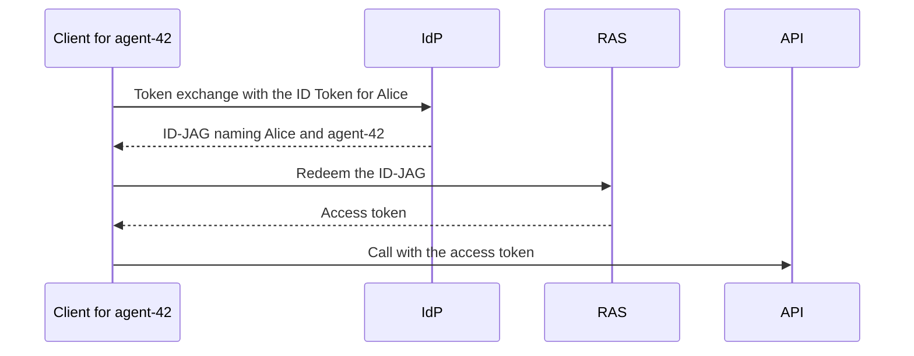
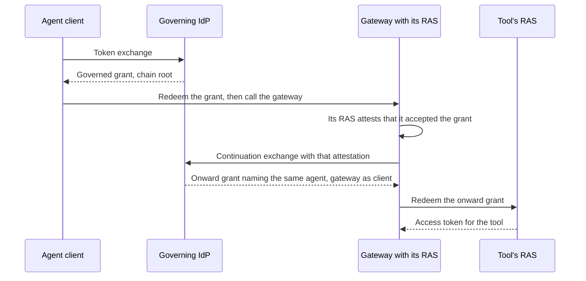
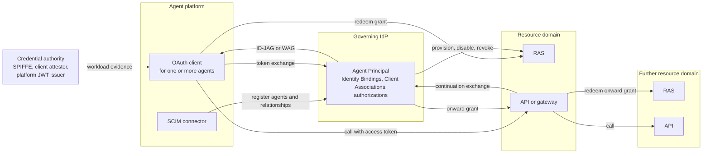

# Governed Agent Profiles: Architecture Overview

This overview is non-normative. A reader should finish it able to
explain the system, choose a deployment model, and understand its
guarantees and limits. The [playbook for identity teams](PLAYBOOK.md)
covers operating a deployment, the [implementer's
guide](IMPLEMENTERS-GUIDE.md) covers configuring and implementing it,
and the drafts define every requirement and govern wherever this
overview differs from them.

One example runs throughout: the enterprise identity provider (IdP)
`https://idp.example/` governs the agent `agent-42`, which acts for the
user Alice through the OAuth client `analysis-client` against the
resource domain whose authorization server (RAS) is
`https://ras.example/` and whose tenant is `acme-data`.
[EXAMPLES.md](EXAMPLES.md) shows the same example's messages.

* [The system in one page](#the-system-in-one-page)
* [Identity, authority, and responsibility](#identity-authority-and-responsibility)
* [Trust between parties](#trust-between-parties)
* [Access flows and deployment variants](#access-flows-and-deployment-variants)
* [Changes, failures, and recovery](#changes-failures-and-recovery)
* [Optional integrations and boundaries](#optional-integrations-and-boundaries)
* [Specification map and glossary](#specification-map-and-glossary)

## The system in one page

### The problem

Enterprises run agents on platforms they do not operate. Each platform
issues its own identity for the workload it runs, and that identity is
not the principal the enterprise governs. The enterprise needs to
recognize, authorize, and audit each agent as one principal across
changes in platforms, workloads, and credentials.

The common workaround is one shared OAuth client per platform
integration. Every agent behind it looks identical to the resource
server, so actions cannot be attributed and revocation becomes all or
nothing.

### Four identities

| Identity | What it is | In the example |
|---|---|---|
| Execution identity | What a platform issues for the workload it runs, or the client's own authentication. It is evidence, not the governed principal | The dedicated client `analysis-client` authenticating to the IdP |
| Agent Principal | The agent the enterprise governs, in the IdP's namespace. It stays the same as platforms, workloads, and credentials change, and its identifier may reuse the execution identity's | (`https://idp.example/`, `agent-42`) |
| OAuth client | The software that requests grants and tokens. Its identifier never stands in for the agent | `analysis-client` at the IdP; `analysis-api` at the RAS |
| User | The person a delegated agent acts for, resolved from the user's own sign-in | Alice, `alice-ras` in the grant, `user-108` at the resource |

`analysis-client` and `analysis-api` are the same client's registrations
at the IdP and at the RAS. The IdP derives the grant's `client_id` from
a configured association between the two, never from the client's
request. For a client that uses one identifier at both servers, such as
a Client ID Metadata Document URL, that association is the identity
mapping.

### How it works

Three parties make the decisions: the IdP identifies the agent and
authorizes its grant, the RAS decides what access to issue, and the API
enforces that access, with its own checks, on each request. The agent's
OAuth client carries the decisions between them:



The IdP resolves the client or workload identity to the Agent Principal
and carries that principal in one of two peer grants, chosen by the
acting relationship. An implementation claims one or both.

| The agent acts | Grant | The resource domain sees |
|---|---|---|
| For a user | ID-JAG | The user as subject and the agent as actor in `act` |
| For itself | Workload Authorization Grant (WAG) | The agent as subject |

```
Execution identity:  OAuth client analysis-client (dedicated client)
                             |  Identity Binding at the IdP
                             v
Agent Principal:     https://idp.example/   agent-42

Delegated ID-JAG for https://ras.example/ (excerpt):
  "sub": "alice-ras",
  "client_id": "analysis-api",
  "act": {"iss": "https://idp.example/", "sub": "agent-42"}

Self-acting WAG (excerpt):
  "iss": "https://idp.example/", "sub": "agent-42"
```

The resource domain correlates the agent with its local principal by
the exact (IdP issuer, agent identifier) pair. For delegated access,
the RAS and API also enforce the actor gate: may this agent act for
this user here? A person's approval and a policy service's evaluation
are optional inputs to these decisions; neither replaces them
([optional integrations](#optional-integrations-and-boundaries)).

### What is required, and what is optional

Every deployment using governed federation needs:

* identity resolution through an Identity Binding, and client authority
  through a Client Association;
* a Delegation or Agent Authorization at the IdP;
* a client registration association, which supplies the grant's
  `client_id` at the RAS;
* the grant, and its redemption at the resource domain's RAS, which
  correlates the agent with a local principal; and
* resource authorization at the RAS and the API, including the actor
  gate for delegated access.

The rest are optional mechanisms, adopted as needed: inputs other than
the dedicated client (the core's existing platform JWT input, which an
implementation needs only to claim generic shared-client
interoperability; a shared client can also use the input profiles), SCIM
administration of the relationships, lifecycle propagation into resource
domains, gateway continuation, human oversight of grants and actions, an
external policy decision point, and Transaction Tokens inside a resource
domain.

## Identity, authority, and responsibility

These parties take part, each owning its own decisions. A credential
authority appears only where workload evidence, rather than the
client's own authentication, identifies the agent:

| Party | Role |
|---|---|
| Agent platform | Runs agents. Can implement the OAuth client that obtains access for them, and a connector that registers them at the IdP |
| Credential authority | Issues the workload evidence the IdP can resolve: SPIFFE, a client attester, or the platform's own JWTs |
| Governing IdP | Holds each Agent Principal and the relationships that govern it, and issues grants naming it |
| Resource domain | Its RAS redeems grants and issues access tokens; its API enforces them |

The IdP holds the relationships. Each answers one question, and none
implies another:

| Relationship | Question | Defined in |
|---|---|---|
| Identity Binding | Which governed agent does this credential identify? | The core |
| Client Association | May this OAuth client use that agent's identity? | The core |
| Delegation Authorization | May the agent act for this user, with what authority? | The core |
| Agent Authorization | What may the agent access on its own behalf? | The core |

Four rules follow:

* **Resolving an identity does not authorize its use.** An Identity
  Binding says which agent a credential represents. A separate Client
  Association says whether a client may exercise that agent. In the
  [delegated flow](#delegated-access), disabling the association leaves
  `agent-42` resolvable but refuses the grant.
* **Attribution is not delegation authority.** In delegated access, the
  user is the subject and the agent the actor, each resolved on its own,
  and user and agent context stay separate in the grant. An
  agent named in `act` acts for the user only under the IdP's delegation
  decision and the resource domain's actor gate. Self-acting access has
  no user: the agent is the subject.
* **Identity confers no authority.** A validated identity does not
  grant authority; authority lives in separate authorizations, so the
  Agent Principal stays the same as its authority changes. Keeping
  domains, intents, and trust realms out of identifiers follows as a
  design choice; the drafts do not require it.
* **Each boundary keeps its own decision.** The IdP owns identity and
  the grant decision; the resource domain owns resource authority. The
  RAS decides anew within the grant, a resource domain's own suspension
  of an agent (a Local Suspension) cannot be cleared from upstream, and
  each resource domain's RAS, not the IdP, issues access to its
  resources. Being known is not being authorized.

Facts cross each boundary only by contract, which states what is
preserved, what is translated, and what is decided anew. The treatment
of each boundary follows [Continuity Is Not One
Thing](https://notes.karlmcguinness.com/notes/continuity-is-not-one-thing/).

### Issuers, tenants, and executions

An Agent Principal is the pair of its IdP's issuer and its identifier,
such as (`https://idp.example/`, `agent-42`). The pair keeps identities
from colliding:

* **Equal identifiers from different IdPs are different agents.** The
  RAS interprets an agent identifier only in its issuer's context and
  never keys authorization on a bare subject. A resource domain served
  by several IdPs keeps the issuer with each record and never merges
  records on equal identifiers.
* **Tenants scope authority, not identity.** The Governance Tenant is
  where the IdP administers the agent; the Target Tenant, such as
  `acme-data`, is where it exercises authority. Neither is part of the
  agent's identity. The RAS correlates the pair within the Target
  Tenant, and a token for one tenant is rejected in another.
* **A new governing authority means a new agent.** Moving an agent to a
  Governance Tenant under a different administrative authority gives it
  a new identifier. Its delegations do not carry forward automatically,
  and resource domains do not re-key their links to the new identifier.

Executions need not have separate principals. Replicas, restarts,
sessions, migrations, and rotated credentials can run as the same Agent
Principal through its Identity Bindings, and none of them creates or
increases
its authority. An execution needs its own Agent Principal only when it
needs separate authorization, delegation, attribution, resource
correlation, or disablement, even if it shares a runtime, client, or
credential with another agent.

### Sub-agents and orchestrators

An orchestrator agent often starts sub-agents for parts of a task. The
same rule decides their identity ("Governance Boundary and Execution
Independence" in the core):

| The sub-agent | Identity | Authority |
|---|---|---|
| Works entirely within its parent's authority and is attributed to it | The parent's Agent Principal; the sub-agent is one more execution of it | The parent's tokens, reused only where their full context (agent, user, tenants, client registrations, RAS, resource, authority, profile, and proof binding) authorizes the operation |
| Needs its own authorization, delegation, attribution, correlation, or disablement | Its own Agent Principal | Its own Client Association and Delegation or Agent Authorization; the parent's authority does not pass to it |
| Acts for the orchestrator, as one agent delegating to another | Out of scope: multi-agent delegation chains are not defined | |

These profiles define no automatic inheritance or cascading withdrawal
between agents. A deployment can explicitly constrain a sub-agent by its
orchestrator's current authority; otherwise, each authorization is
narrowed or withdrawn separately. The implementer's guide covers
[the patterns](IMPLEMENTERS-GUIDE.md#sub-agents-and-orchestrators).

## Trust between parties

Every arrow in the flows rests on an agreement configured at both ends
before the first request. The drafts require each agreement, not a
format for it; the implementer's guide lists the items under [Federation
configuration](IMPLEMENTERS-GUIDE.md#federation-configuration). None of
them comes from a request: request parameters, presented credentials,
and discovered metadata never create or widen one. Each boundary below
states what is configured, what is checked on each request or
administrative write, and what happens when the check fails. Adding a
resource domain, a credential issuer, or a gateway means configuring its
boundary at both ends. The IdP → RAS and RAS → API boundaries are
part of every deployment, and Credential authority → IdP of every
deployment that resolves agents from workload evidence; the others come
with optional capabilities. The implementer's guide indexes the OAuth
errors these failures return ([Errors and
recovery](IMPLEMENTERS-GUIDE.md#errors-and-recovery)).

### Credential authority → IdP

* **Configure:** each trusted issuer or trust domain, with its approved
  keys, algorithms, time limits, and accepted audiences, and the
  credential class that tells its workload credentials apart from its
  user or management tokens. Identity Bindings name an exact issuer and
  subject.
* **Validate:** the IdP selects exactly one configured class for
  presented evidence, validates the evidence under it, and resolves the
  exact identity through an enabled binding.
* **On failure:** for presented evidence, such as a platform JWT, an
  ambiguous class makes the request malformed, and evidence that fails
  validation, or matches no enabled binding, identifies no agent.
  Neither falls back to another class or to the client's own
  authentication. A rejected SVID or Client Attestation, which resolves
  from client authentication, fails that authentication.

### IdP → RAS

* **Configure:** the RAS trusts the IdP as issuer of its ID-JAGs or
  WAGs and of the agent namespace. The IdP holds a client registration
  association for each client at that RAS, the Target Tenant for each
  resource, and whether it may assert local account identifiers there.
  Both hold the minimum profile for each client, trust relationship, and
  resource.
* **Validate:** the IdP derives each grant's `client_id` from the
  association, never from the request. The RAS validates the grant, its
  issuer and namespace, the client, and the proof, and correlates the
  agent by the exact pair in the Target Tenant.
* **On failure:** with no client registration association, the IdP
  issues nothing for that target. A grant from an untrusted issuer or
  namespace, or a bound grant without its proof, is an invalid grant at
  the RAS. Each server enforces its own minimum profile, and nothing is
  retried at a lower one.

### RAS → API

* **Configure:** the resource's minimum profile; how each token's
  population, delegated or self-acting, is established (separate client
  registrations, audiences, or issuers; one registration and audience
  for both needs an additional bilateral contract, such as an
  introspection member the RAS and API agree on); how the token carries
  the tenant, by default a tenant-specific audience; the access-token
  protection; and whether the API introspects or validates offline.
* **Validate:** the API validates the token and its proof, takes the
  population from that configuration and never from whether `act` is
  present, checks the tenant, and applies the actor gate or the agent's
  own permissions.
* **On failure:** a token whose applicability is ambiguous, a
  delegated-population token without `act`, or a token for another
  tenant is an invalid token. A valid actor that the gate denies is
  refused authority, and an evaluation that cannot complete is
  unavailable, not a denial, unless an earlier-ranking failure is
  already established. The validation mode decides how soon a
  revocation at the RAS reaches the API.

### Platform → IdP

* **Configure:** the connector, its Governance Tenant, and its
  Provisioning Domain, and the credential authorities, source
  identities, OAuth clients, and agents it may use. Registering an
  agent, binding an identity to it, and authorizing a client to use it
  are separate permissions, and permission to disable never implies
  permission to enable.
* **Validate:** the IdP authorizes each write against that context,
  including the connector's authority over both ends of every binding
  and association, both when it is created and when it is enabled.
* **On failure:** the write is rejected with a SCIM error. The
  permissions stay separate because a binding or association write can
  let an identity act as an enterprise agent.

### Lifecycle sender → receiver

* **Configure:** a Provisioning Domain naming one governing IdP issuer,
  one Target Tenant, and the connectors authorized for them. For events:
  the stream's transmitter, audience, and source service, and the
  ID-JAG issuer whose grants it may revoke.
* **Validate:** the receiver takes the issuer from that configuration,
  never from a provisioned attribute, and authorizes changes to
  `active` separately from descriptive edits.
* **On failure:** a revocation naming another issuer's grant is
  rejected. A transport failure or partial result leaves reconciliation
  incomplete and is never read as a deletion. The receiver's Local
  Suspensions and resource permissions stay its own: upstream
  activation cannot clear them.

### Gateway's RAS → IdP

* **Configure:** the IdP trusts the gateway's RAS, or an issuer trusted
  for it, as Continuation Assertion Issuer for its hops, with the same
  canonical identity for the gateway configured at both. A Continuation
  Association permits the gateway to continue the agent's chains in one
  acting relationship.
* **Validate:** the IdP validates the assertion, matches the identity
  in it to the authenticated gateway, and applies the Continuation
  Association and the chain's governance checks. The assertion shows
  only that the RAS accepted the hop.
* **On failure:** without a Continuation Association, the IdP refuses
  the continuation, and the gateway does not fall back to its own
  authority.

## Access flows and deployment variants

Every deployment starts from two flows: an agent acting for a user, and
an agent acting for itself. Both use the running example, with the
identifiers of the core's [walkthrough][core-walkthrough]. The
implementer's guide's
[primer](IMPLEMENTERS-GUIDE.md#primer-two-grants-one-identity-model)
walks both message by message. Four variants follow, each in the same
shape: when to use it, its prerequisites, what changes, and its
limitations. Domains are always crossed with grants: an ID-JAG or WAG,
or continuation through a gateway, so the target domain validates a
grant from the IdP it already trusts. Tokens bound to one trust domain,
such as Transaction Tokens, stay inside it. [Platform-hosted
agents](#platform-hosted-agents) can use registration and lifecycle
governance without federation; they need no Identity Binding, Client
Association, or IdP-issued grant until they federate.

### Delegated access

`agent-42` reads the file `report-7` in `acme-data` for Alice. Each
party decides one question, from facts it can verify itself:

| Step | Party | Decides | From |
|---|---|---|---|
| Sign-in | IdP | Who the user is | Alice's sign-in, and an ID Token whose audience is `analysis-client` |
| Resolution | IdP | Which agent the client is | `analysis-client`'s `private_key_jwt` authentication, which the Identity Binding maps to `agent-42` |
| Client authority | IdP | Whether this client may use that agent for delegated access | The Client Association |
| Delegation | IdP | Whether `agent-42` may act for Alice at this resource, with `files.read` | Alice's Delegation Authorization |
| Grant | IdP | What the RAS receives | ID-JAG `grant-1`: `sub` `alice-ras`, `act` (`https://idp.example/`, `agent-42`), `client_id` `analysis-api`, bound to the client's DPoP key |
| Redemption | RAS | Whether to issue access, and how much | The IdP's signature and its trust for the `act` namespace; the client's RAS authentication and key proof; its own records for `agent-42` and Alice; the actor gate and its own policy. The grant sets a ceiling; it does not oblige the RAS to issue |
| Access | API | Whether this operation is allowed | Access token `access-1` and its proof; the tenant in its audience; Alice's permissions; the actor gate |

Three properties follow from that division:

* **The agent is named once and enforced at three points.** The IdP
  resolves it, the RAS correlates the exact (issuer, agent) pair with
  its own record, and the API applies the actor gate. All three rely on
  the IdP's assertion of the agent; they are not independent checks of
  its identity.
* **Resolution and authorization fail separately.** With the Client
  Association disabled, the Identity Binding still resolves `agent-42`,
  but the IdP refuses the grant, and nothing reaches the RAS.
* **The client never stands in for the agent.** `analysis-api` is the
  client at the RAS, and the access token keeps `agent-42` in `act`, so
  agents that share a client remain distinct actors.

The walkthrough's RAS issues no refresh token. When `access-1` expires,
the client obtains a new ID-JAG, and the IdP decides again. The
playbook's [delegated
recipe](PLAYBOOK.md#recipe-delegated-access-to-a-saas-application)
deploys this flow, tests it, and stops and restores it.

### Self-acting access

`agent-42` runs a job on its own authority, with no user. Resolution is
the same: one binding, one Agent Principal. The authority is different:

| Step | Delegated | Self-acting |
|---|---|---|
| The client presents | Alice's ID Token as the subject token | Its own authentication JWT, repeated as the subject token |
| The IdP checks | The Client Association for delegated issuance, and Alice's Delegation Authorization | The Client Association for self-acting issuance, and the agent's Agent Authorization |
| The grant | ID-JAG: the user as `sub`, the agent in `act` | WAG `wag-1`: `agent-42` as `sub`, no `act` |
| The RAS | Resolves Alice and the agent, and applies the actor gate | Correlates `agent-42` to its local principal `service-principal-42`, and applies that principal's policy |
| The access token | `sub` `user-108`, `act` `agent-42` | `sub` `service-principal-42`, no `act`, and never a refresh token |
| The API | Alice's permissions and the actor gate | The agent's own permissions, with no actor gate |

Neither authorization implies the other. Withdrawing Alice's delegation
leaves the agent's own access unchanged, and withdrawing the Agent
Authorization leaves Alice's delegation in place. Where both flows
reach one API, the API tells their tokens apart from trusted
configuration, such as a separate client registration or audience, or
from authenticated issuance context. It never relies on the absence of
`act`, which would let a malformed delegated token pass as self-acting.
The core's [self-acting variant][core-wag-example] shows the messages,
and the playbook's
[self-acting recipe](PLAYBOOK.md#recipe-self-acting-access) deploys and
tests the flow.

### Shared platform clients

* **When to use:** a platform runs many agents behind one OAuth client,
  such as its single sign-on client, instead of registering a client per
  agent.
* **Prerequisites:** the IdP trusts the platform as a credential issuer
  for that client, with its issuer, credential class, keys, algorithms,
  time limits, and accepted audiences configured together with the
  client. Each agent has an Identity Binding naming the exact issuer and
  subject of its workload, and a Client Association for the shared
  client.
* **What changes:** the client authenticates as itself and presents the
  platform's existing JWT for the agent's workload: as the actor token
  for delegated access, or as the subject token for self-acting access.
  The RAS and API see no difference; the grant names the agent, and
  `client_id` is the shared client's registration.
* **Limitations:** the client's authentication cannot tell its agents
  apart, so a token it holds for one agent is never reused for another,
  even with a matching scope. A platform JWT that fails validation is
  rejected and is not retried under another credential class. The core's
  [AWS example][core-aws-example] shows the input.

### Continuation through gateways

* **When to use:** an agent reaches tools through a gateway, such as a
  Model Context Protocol (MCP) gateway, that selects a tool at request
  time and calls it in another resource domain. The gateway holds
  neither the user's credential nor the agent's, and calling the tool as
  itself would make every agent behind it look the same: the
  shared-client problem again.
* **Prerequisites:** the continuation profile at the IdP, the gateway,
  and the gateway's RAS; trust in that RAS as Continuation Assertion
  Issuer; a Continuation Association for the gateway; tenant policy, and
  the user's delegation or the agent's own authorization, that permit
  continuation through other clients; a sender-constrained access token
  at the gateway, unless resource policy permits continuation from
  bearer tokens; and DPoP at the target RAS's token endpoint.
* **What changes:** the gateway continues the agent's chain instead of
  calling as itself.



The onward grant names the same Agent Principal and, for delegated
access, the same user. A RAS and API that implement the core, with DPoP
at the RAS token endpoint, accept it unchanged; every onward grant is
bound to the gateway's key.
The gateway is the grant's client, never an added actor; a separate
`continuation_via` claim lists the gateways on the path.

* **Limitations:** the API sees `continuation_via` only where the target
  RAS supports path disclosure. A chain ends when its anchor  ends, such
  as the user's IdP session, and on governance events: disabling the
  agent or user, disabling the root binding or association, revoking
  (not rotating) the root credential, or withdrawing the root
  authorization as a whole. Narrowing an authorization stops
  continuation only to what was removed. Restrictions in the chain
  authorization or a Continuation Association can limit targets,
  authority, and continuing clients, and an authorization from a
  deferred redemption is never eligible for continuation. Self-acting
  chains anchor to an agent session that only the agent's own
  authentication keeps active, so a gateway cannot keep a stopped
  agent's chains alive. The continuation profile requires the IdP to
  enforce a continuation window, so continuation from a source hop stops
  once that window passes, even while the agent's access token at the
  gateway is still accepted.

### Scheduled work

* **When to use:** an agent works for a user after the user signs out,
  such as preparing a daily report.
* **Prerequisites:** an IdP that claims grant-anchored continuation and
  accepts refresh-token subjects from the agent's client; a refresh
  token for the user whose grant carries the user's Delegation
  Authorization, which permits continuation; tenant policy that permits
  it; a continuation-aware RAS at the agent's operator, trusted as
  Continuation Assertion Issuer, that holds the task record; and a
  Continuation Association for the agent's client.
* **What changes:** while the user is signed in, the client uses the
  refresh token once to root a chain anchored to its grant. Each run
  continues from the task record and obtains a new ID-JAG for the
  target, with no retained user credential. The target RAS processes
  that grant as in the delegated flow.
* **Limitations:** delegated access only. The continuation window must
  cover the task; once the chain's first hop passes its deadline, the
  task needs a new chain. Withdrawing the user's delegation, or revoking
  the refresh-token grant, ends the chain, and the next run fails. The
  continuation profile's [scheduled variant][continuation-scheduled]
  shows the messages.

### Platform-hosted agents

* **When to use:** a platform, such as a data or application platform,
  hosts agents for a customer that use only the platform's own tools and
  resources, and must keep running when the IdP is unavailable. The
  enterprise still wants them in one inventory, under one governance
  decision, and visible in its monitoring.
* **Prerequisites:** the SCIM management profile for registration, and
  the platform as the lifecycle Receiver for its own agents.
* **What changes:** the IdP stays out of the platform's runtime path.
  * **Register, don't federate.** The platform's connector registers
    each hosted agent at the IdP as an Agent with no Identity Binding or
    Client Association. The agent is visible and governed but cannot
    obtain an IdP grant.
  * **Split authority.** The platform owns the agent's existence,
    description, and deletion. The IdP owns the governance decision,
    `active`, and the connector's authority to register or describe an
    agent does not include re-enabling one the IdP disabled.
  * **Apply governance locally.** Once the platform applies the IdP's
    disablement, it denies new authorization and revokes the agent's
    existing authorization in its own system. Its own suspension is a
    Local Suspension the IdP cannot clear.
* **Limitations:** the platform authorizes from locally applied state,
  so an unreachable IdP neither disables nor re-enables its agents; a
  bound on stale state needs a revalidation policy. To reach a resource
  beyond the platform, an administrator adds an Identity Binding and a
  Client Association for the selected acting relationship to the same
  Agent; in SCIM management, a dedicated-client binding carries the
  association for delegated access. Its identifier and governance
  history carry over.

The implementer's guide
[follows one agent](IMPLEMENTERS-GUIDE.md#platform-hosted-agents) from
registration through third-party access and retirement, and the
lifecycle draft's [platform-hosted example][lifecycle-example] shows its
risk signals, disablement, and re-enablement.

### One deployment, end to end

The optional mechanisms compose without changing the core. A platform's
connector can register the agent (SCIM management); a gateway can ask a
policy decision service about each action and continue the agent's chain
to a tool in another domain (continuation); a Transaction Token can
carry the user, the agent, the client, and the authorized operation
through the tool's internal services; and lifecycle propagation can
provision, disable, and revoke. Each leaves the core's grant,
redemption, and resource authorization unchanged.
[EXAMPLES.md](EXAMPLES.md) shows the gateway and its approval with
messages, and the implementer's guide covers [Transaction Tokens inside
a resource
domain](IMPLEMENTERS-GUIDE.md#transaction-tokens-inside-a-resource-domain)
and [risk signals](IMPLEMENTERS-GUIDE.md#risk-signals).

### What each choice costs

The security controls carry these deployment costs. The threats behind
them are in the core's [Security Considerations][core-security].

| Requirement | Benefit | Cost |
|---|---|---|
| Dedicated-client resolution as the common mode | Reuses deployed client authentication and registered keys | One Agent Principal per client identity; proves registered-client identity, not independent runtime or workload provenance |
| Optional native JWT-SVID input ([input profiles][inputs]) | Reuses SPIFFE issuance, client authentication, and trust-domain validation | Bearer evidence; issuer-bound presenter proof needs another supported input |
| Bound profile: DPoP at both token endpoints; grant bound to the grant proof key | A stolen ID-JAG cannot be redeemed without the key | Every client holds and proves a key |
| Actor-aware API processing | The actor gate is enforced where access happens | APIs parse `act` and consult the gate on delegated paths |
| Sender-constrained access tokens by default | Token theft is contained | Resources without DPoP or mutual TLS need explicit configuration for bearer use |

Bound grants also need one key holder for issuance and redemption, and
opaque access tokens add an introspection round trip and a freshness
policy; the implementer's
guide covers [key
use](IMPLEMENTERS-GUIDE.md#distributed-platforms-and-key-use) and
[optional
exchanges](IMPLEMENTERS-GUIDE.md#optional-exchanges-within-the-core).

## Changes, failures, and recovery

Identity and authority have separate owners, checks, and lifetimes, so
each change ends something different. A change stops new authorization
at the component that makes the decision once that component applies
it, the IdP within its configured freshness limit. Anywhere else, it
takes effect only when that component applies it, and authority already
issued runs until its own revocation or expiry.

| Change | New authorization stops | Already issued | Restored by |
|---|---|---|---|
| Disable an Identity Binding | At the IdP, through that binding; other bindings continue. Chains rooted through it end | Grants and RAS tokens, until revoked or expired | Re-enabling it; ended chains stay ended |
| Remove a Client Association | At the IdP, for that client's use of the binding. Chains rooted through it end | Grants and RAS tokens, until revoked or expired | Restoring it; ended chains stay ended |
| Withdraw a user's delegation, or an Agent Authorization, as a whole | At the IdP, for that authorization; chains rooted under it end | Delegated: RAS authorization, until revoked or its absolute expiration. Self-acting: access tokens and any still-redeemable WAG, until they expire | Restoring it; a new root grant for ended chains |
| Narrow an authorization by removing targets or authority | New grants and continuation for what was removed are refused; chains continue to other targets | Tokens already issued for the removed targets, until revoked or expired | Restoring the targets or authority |
| Disable the Agent Principal | At the IdP, for every binding and client; every chain for the agent ends | Once a resource domain applies the change, redemption and refresh are denied there and the agent's sessions are revoked | Re-enabling it permits new decisions; revoked sessions and ended chains stay ended |
| Revoke one ID-JAG through the optional grant-derived revocation capability | Its redemption, at participating receivers in the target tenant | The authorization derived from it there is revoked; the agent stays enabled | A new grant; the revoked one stays unusable |
| Apply a Local Suspension | In that resource domain, regardless of upstream state | API access stops when its policy observes the change, introspection reports the token inactive, or the token expires | Only the resource domain lifting it; upstream activation cannot. A provisional suspension caused by a deactivation event can also be cleared by successful reconciliation |
| Remove a Continuation Association | That client's continuation of the agent's chains; the chains continue through other clients | Tokens already obtained, until revoked or expired; a target's refresh token extends access further | Restoring it |

Re-enabling never restores revoked sessions. Current administrative
state cannot reveal a missed disable-and-re-enable cycle, and how
quickly an API stops accepting tokens depends on introspection, caching,
and token lifetimes. Without a bound on propagation and enforcement,
the drafts claim no finite end-to-end denial time; a deployment should
document its expected and maximum delay.

### Failures

A component that cannot reach another keeps the decisions it has
already applied, unless a configured stale-state bound expires, and
makes no decision that needs the missing input. The implementer's guide
indexes the OAuth errors these failures return ([Errors and
recovery](IMPLEMENTERS-GUIDE.md#errors-and-recovery)).

| Failure | What stops | What still works | Recovery |
|---|---|---|---|
| The IdP is unavailable | New grants, including onward grants | Valid access tokens and redeemable grants | New grants once it returns |
| Lifecycle delivery is delayed or lost | The undelivered change stops nothing until it is applied; a revalidation bound denies new authorization and refresh once it passes | Decisions on the last applied state | Reconciliation with the source |
| The RAS has no record for the agent | Its redemptions, unless just-in-time correlation applies | Agents already correlated | Provisioning, or just-in-time correlation |
| Introspection is unavailable at the API | Requests that need a check | Cached active responses, within the cache policy | Requests succeed once it returns |
| A policy decision service is unavailable | Operations that need its decision; the API answers that it is unavailable, not that it denies, unless a failure is established and no unfinished check ranks earlier | Operations the API decides without it | A retry after any `Retry-After` interval |
| A continuation is refused | That continuation; once the chain has ended, every continuation of it | Tokens already issued, for their lifetimes | A new root grant once the chain has ended; otherwise a different request, or a retry under a rate limit's policy |

**The IdP is unavailable.** Grants already issued stay redeemable under
their own rules: an unbound grant once, and a bound grant again only
where RAS policy permits. Where a RAS issued a refresh token under
explicit policy, delegated access can refresh within its absolute
expiration; self-acting access ends only when the client has neither an
acceptable access token nor a redeemable WAG. Platform-hosted agents
keep authorizing on applied state until any stale-state bound expires.
An IdP that is reachable but cannot confirm shared state a continuation
depends on answers HTTP 503, a temporary refusal that is not an error
response: the chain does not end, and the gateway can retry the same
request with the same assertion while it is unexpired, after any
`Retry-After` interval, with a fresh client assertion and DPoP proof.

**Lifecycle delivery is delayed or lost.** A disablement not yet
applied in a resource domain stops neither redemption, refresh, nor
sessions there. A delayed activation notice triggers retrieval of
current state, never an activation, and a missed disable-and-re-enable
cycle cannot be recovered from current state.

**The RAS has no record for the agent.** Where
resource policy enables just-in-time correlation for that issuer and
tenant, the RAS can create the record from the validated grant,
applying local restrictions and policy before issuance. A record
created just in time still needs lifecycle integration to learn of
disablement.

**A policy decision service is unavailable.** Unless a failure is
established and no unfinished check ranks earlier, the API answers HTTP
503, normally with `Retry-After` ([core, Error
Responses][core-resource-errors]). A COAZ-MCP enforcement point fails
closed and returns an error of its own; the drafts do not yet say how
that composes with the core's 503. Whether local policy can stand in for
the unavailable service is not settled either. Where an IdP issuance
decision depends on resource-domain evaluation through that service, the
IdP cannot make it.

**A continuation is refused.** Once the chain has ended, the gateway
should reject the agent's request as an invalid token, so that the
agent's client obtains a new root grant. After a limit or
continuation-window failure, the chain continues: the gateway fails only
the request, with an error of its own API, and the failure alone does
not invalidate the agent's access token. In either case, the gateway
never calls the tool with its own authority.

## Optional integrations and boundaries

These integrations sit beside the required flow. None is needed to
federate an agent, and each has a different standing in the drafts, so
an example here is not a promise of interoperability:

| Integration | Standing |
|---|---|
| The companion profiles: inputs, continuation, SCIM management, OAuth client management, and lifecycle | Defined protocol behavior ([specification map](#specification-map-and-glossary)) |
| Grant-derived revocation of one ID-JAG | Optional capability with defined requirements, in the lifecycle profile |
| An external policy decision service | Optional capability with defined requirements ([below](#policy-decision-services)) |
| An AuthZEN or COAZ-MCP message mapping | Unresolved composition: the core names AuthZEN as one interface and defines no mapping; the AuthZEN working group plans an OAuth mapping profile |
| AuthZEN Token Issuance or Token Exchange profiles at the IdP | Unresolved composition: compatible with the core's issuance authorization, which a decision can narrow but not broaden, but neither profile makes the resolved Agent Principal a mandatory decision input |
| Transaction Tokens inside a resource domain | Illustrative deployment composition, in the [implementer's guide](IMPLEMENTERS-GUIDE.md#transaction-tokens-inside-a-resource-domain) |
| Credential brokers | Illustrative deployment composition, in the [implementer's guide](IMPLEMENTERS-GUIDE.md#credential-brokers) |
| Human oversight: approval before issuance or redemption, supervised issuance, and per-action approval | Defined protocol behavior ([below](#human-oversight)) |
| Approved work, such as Mission-Bound Authorization | Outside these drafts ([below](#beyond-these-drafts)) |

### Human oversight

The [oversight profile][oversight] adds a person to governed access.
With a human in the loop, an approver decides before a grant issues,
before a RAS issues access, or before an action executes; with a human
on the loop, an overseer sees each grant as it issues and can end it.
Without the profile, standing authorization decides alone (human out of
the loop). For approval before a grant or before access, the IdP or the
RAS holds the request under OAuth Deferred Token Response until the
approver decides; at the RAS this is deferred redemption. Policy at each
decision point selects the mode; a client's opt-in to waiting never
does.

Approval permits this request; it does not create standing authority.
An audit identifier can correlate the approval but cannot establish
authorization. For deferred redemption, token lifetimes are bounded by
the approval and other applicable deadlines, and the resulting
authorization cannot be continued.

* **Approval at the IdP and at the RAS end differently.** At the IdP,
  approval yields a grant that the RAS redeems and the API enforces like
  any other. At the RAS, it yields the access token itself, and every
  refresh is evaluated again with the approval. Approval at one decision
  point does not satisfy another.
* **The approver is authenticated.** An approver authenticates at the
  strength policy requires; a confirmation from the client or the agent
  is not an approval, and a denial issues nothing.
* **Some compositions are unresolved.** At the RAS, the oversight
  profile binds each approval to one pending redemption, and the AuthZEN
  [Access Request and Approval Profile][arap] (ARAP) and [Access Request
  OAuth Profile][arop] (AROP) can realize that binding. At the IdP,
  completing an approved request as a token through AROP is an excluded
  composition of the core: an approval there bounds only the grant, and
  ARAP does not yet bind an approval to a governed request's resolved
  identities.

The implementer's guide covers [configuration and waiting
limits](IMPLEMENTERS-GUIDE.md#human-oversight), and EXAMPLES.md shows
[approval at issuance](EXAMPLES.md#approval-at-issuance) and [at
redemption](EXAMPLES.md#approval-at-redemption).

### Policy decision services

A resource domain can ask a policy decision service whether to permit
one operation, such as one MCP tool call, through the OpenID AuthZEN
Authorization API or another interface; the drafts define no mapping to
any of them. Whatever the service, the core's [Optional Policy
Services][core-policy-services] rules apply:

* the API keeps the user, the issuer-qualified Agent Principal, and the
  OAuth client distinct, and supplies the tenant and token constraints;
* it takes them only from the validated token, or an authenticated
  introspection response, and trusted configuration, never from request
  attributes such as a tool call's arguments;
* a permit never widens the token; and
* the decision says whether the actor gate denied, or the API evaluates
  the gate itself, so that it can report the right failure.

[COAZ-MCP][coaz-mcp], the AuthZEN binding for MCP tool calls, names the
client as the agent by default, which for a shared client or a gateway
is the same for every agent behind it. The API supplies the agent from
the validated `act` or, for a self-acting token, the correlated subject,
as the token population configured for the resource selects. The
implementer's guide has the [integration points and illustrative
requests](IMPLEMENTERS-GUIDE.md#authorization-decisions-with-authzen),
and [COORDINATION.md](COORDINATION.md) the changes proposed to the
AuthZEN profiles.

### Beyond these drafts

These drafts define agent identity and authority up to the allow or deny
decision at an action. Approved work is a third concern with its own
owner: being authorized is not being approved for this work. Work
context and per-action authorization belong to other specifications:

| Concern | Question | Responsibility | Specifications |
|---|---|---|---|
| Identity | Which governed agent is acting? | The IdP resolves the Agent Principal; the resource domain correlates it locally | These drafts |
| Authority | What may it do, and for whom? | The IdP authorizes the grant; the resource domain decides within its limits | These drafts; AuthZEN and COAZ for per-action decisions ([above](#policy-decision-services)); ARAP and AROP for access requests after a denial ([above](#human-oversight)) |
| Work | Does approved work still justify this action? | A mission control point supplies and evaluates work context; ending a Mission denies actions at every boundary that checks work state | [Mission-Bound Authorization](https://github.com/mcguinness/mission-bound-authorization) |

Also outside these drafts: identity continuity across a chain of IdPs,
multi-agent delegation chains, authorization of individual client
instances, and enrollment and key-replacement protocols. This overview
also leaves out request provenance through intermediaries other than
governed continuation, and behavioral monitoring and anomaly detection;
the lifecycle profile carries anomaly signals but detects nothing.

## Specification map and glossary

The standards the drafts build on exist separately and do not yet
compose:

* OAuth 2.0 Token Exchange defines `act` but leaves the actor's meaning
  to profiles.
* The Identity Assertion JWT Authorization Grant (ID-JAG) brokers
  cross-application access through the IdP both sides already trust for
  single sign-on, and leaves actor validation, authorization, and
  representation to extensions.
* Attestation-based and SPIFFE client authentication establish which
  OAuth client is calling, not which agent a shared client is acting
  for.

**Start with the core.** The [OAuth 2.0 Profile for Governed Agent
Federation][core] is an OAuth deployment profile that standardizes the
boundary between execution identity and governed identity. A client,
IdP, RAS, and API can implement dedicated-client federation, one OAuth
client per agent, from the core alone. Shared platforms use their
existing platform JWT, also defined in the core, to distinguish the
agents behind one client. Identity resolution, client authority, user
delegation, and resource authorization remain separate decisions, and
no new workload credential format is defined. Two adoption profiles
differ in grant protection: bound governed agent access requires DPoP
at issuance and redemption.

The [README](README.md#the-drafts) lists the companion profiles and
when to add each.

### How they connect



| Connection | Defined in |
|---|---|
| Token exchange, grant, redemption, call | OAuth 2.0 Profile for Governed Agent Federation (the core) |
| Workload evidence | The core (dedicated client, platform JWT); Agent Resolution Input Profiles (SPIFFE, Client Attestation) |
| Register agents and relationships | SCIM Profile for Governed Agent Federation Management, with OAuth clients from the SCIM Profile for OAuth 2.0 Client Management |
| Provision, disable, revoke | Governed Agent Lifecycle Profile for SCIM and OAuth |
| Continuation exchange, onward grant | Identity Continuation Profile for Governed Agent Federation |

What each draft needs from the specifications it depends on is in
[COORDINATION.md](COORDINATION.md).

### Glossary

| Term | Meaning | Defined in |
|---|---|---|
| Acting relationship | Whether the agent acts for a user (delegated) or for itself (self-acting) | The core |
| Actor gate | The check, at the RAS and the API, that the issuer-qualified agent may act for the user in the selected tenant and resource | The core ("Delegated Actor Authorization") |
| Agent Authorization | The IdP's decision that an agent may access a target on its own behalf, within an approved client, tenant, target, and authority | The core |
| Agent Principal | The stable principal, in the IdP's namespace, that the enterprise governs as one agent; identified by its IdP's issuer and its identifier | The core |
| Agent session | IdP state recording that an agent recently authenticated through one Identity Binding; it anchors self-acting chains | Continuation |
| Bound governed agent access | The adoption profile that requires DPoP at grant issuance and redemption | The core |
| Chain, hop | The IdP's record of grants continued from one root grant; each grant in it is a hop | ICA, as the continuation profile uses it |
| Client Association | Permission for an OAuth client to use an agent through the selected Identity Binding, in one acting relationship and credential class | The core |
| Client registration association | The IdP's mapping from an authenticated client to its registration at a target RAS, which supplies the grant's `client_id`; not a Client Association | The core ("Issuance Prerequisites") |
| Continuation Assertion Issuer (CAI) | The issuer that attests, for a continuation exchange, that a RAS accepted a hop, that its authorization is active, and that the continuing client is associated with it | Identity Continuation Assertion (ICA) |
| Continuation Association | Permission for a client to continue an agent's governed chains in one acting relationship | Continuation |
| `continuation_via` | The onward grant's claim listing the continuing clients on the path | Continuation |
| Continuing client | The client, usually a gateway, that continues a chain: it obtains the assertion, exchanges it at the IdP, and redeems the onward grant | Continuation |
| Credential class | A configured category of agent-resolution input with its own validation rules, such as a client assertion, a SPIFFE SVID, Client Attestation, or a platform's workload JWT | The core |
| Dedicated client, shared client | A dedicated client's authenticated identity maps to one agent. A shared client serves several agents, so resolving one needs workload evidence | The core |
| Delegation Authorization | The IdP's decision that an agent may act for a user, within an approved client, tenant, target, and authority | The core |
| Governance Tenant | The IdP's administrative scope for an agent and its relationships; not part of the agent's identity | The core |
| Governed agent access | The adoption profile that permits unbound grants only where trusted policy explicitly allows them | The core |
| Grant-derived revocation | Optional revocation, by a CAEP event, of the authorization one ID-JAG produced in a tenant | Lifecycle |
| ID-JAG | Identity Assertion JWT Authorization Grant: the delegated grant, with the user as subject and the agent in `act` | ID-JAG, profiled by the core |
| Identity Binding | An approved association from an exact client or workload identity to one agent; it resolves the agent and grants no permission | The core |
| Local Suspension | A resource-domain restriction independent of the IdP's state; upstream activation cannot clear it | Lifecycle |
| Onward grant | An ID-JAG or WAG issued on a continuation exchange | Continuation |
| Provisioning Domain | In a resource domain, configuration naming one governing IdP issuer, one Target Tenant, and the connectors authorized to manage them. At the IdP, one connector's management authority within one Governance Tenant | Lifecycle; SCIM management |
| RAS | The resource domain's authorization server, which redeems grants and issues access tokens | The core |
| Resource domain | A RAS and the APIs it issues access tokens for | This overview |
| Target Tenant | The tenant at the RAS in which the agent or user exercises authority | The core |
| Transaction Token | A short-lived token carrying identity and context through a call chain inside one trust domain | OAuth Transaction Tokens |
| WAG | Workload Authorization Grant: the self-acting grant, with the agent as subject | WAG, profiled by the core |

[core]: https://mcguinness.github.io/governed-agent-profiles/draft-mcguinness-oauth-governed-agent-federation.html
[core-walkthrough]: https://mcguinness.github.io/governed-agent-profiles/draft-mcguinness-oauth-governed-agent-federation.html#walkthrough
[core-resource-errors]: https://mcguinness.github.io/governed-agent-profiles/draft-mcguinness-oauth-governed-agent-federation.html#resource-errors
[core-policy-services]: https://mcguinness.github.io/governed-agent-profiles/draft-mcguinness-oauth-governed-agent-federation.html#policy-services
[core-security]: https://mcguinness.github.io/governed-agent-profiles/draft-mcguinness-oauth-governed-agent-federation.html#security
[arap]: https://openid.github.io/authzen/authzen-access-request-approval-profile-1_0.html
[arop]: https://github.com/openid/authzen/blob/main/profiles/authzen-access-request-oauth/authzen-access-request-oauth-profile-1_0.md
[coaz-mcp]: https://openid.github.io/authzen/authzen-coaz-mcp-binding-1_0.html
[core-wag-example]: https://mcguinness.github.io/governed-agent-profiles/draft-mcguinness-oauth-governed-agent-federation.html#wag-example
[core-aws-example]: https://mcguinness.github.io/governed-agent-profiles/draft-mcguinness-oauth-governed-agent-federation.html#aws-example
[inputs]: https://mcguinness.github.io/governed-agent-profiles/draft-mcguinness-oauth-governed-agent-inputs.html
[continuation-scheduled]: https://mcguinness.github.io/governed-agent-profiles/draft-mcguinness-oauth-governed-agent-continuation.html#walkthrough-scheduled
[oversight]: https://mcguinness.github.io/governed-agent-profiles/draft-mcguinness-oauth-governed-agent-oversight.html
[lifecycle-example]: https://mcguinness.github.io/governed-agent-profiles/draft-mcguinness-oauth-governed-agent-lifecycle.html#platform-example
