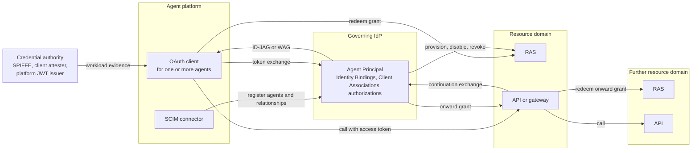
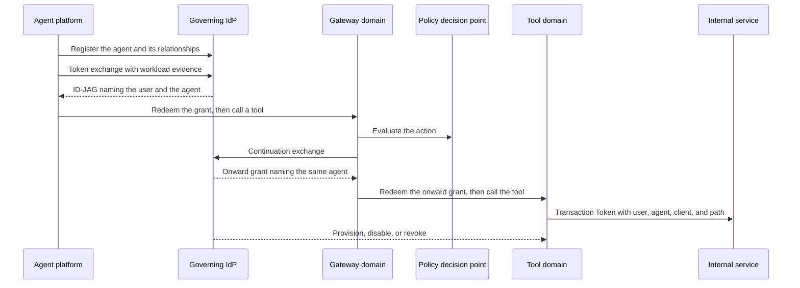
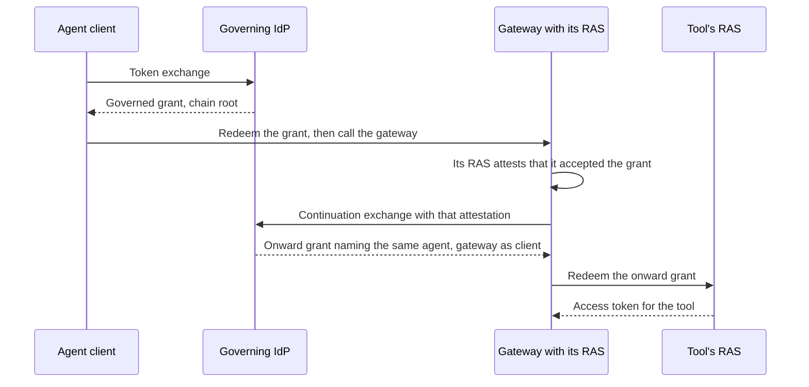

# Governed Agent Profiles: Architecture Overview

This overview is non-normative. It explains the problem the governed
agent profiles address, how they work, the principles behind them, and
how the six drafts fit together. The drafts define every requirement,
and they govern wherever this overview differs from them. For
message-level flows, what each role builds, and deployment
configuration, see the [implementer's guide](IMPLEMENTERS-GUIDE.md).

* [The problem](#the-problem)
* [How it works](#how-it-works)
* [Principles](#principles)
* [Design choices](#design-choices)
* [How the drafts fit](#how-the-drafts-fit)
* [End to end](#end-to-end)
* [Continuation through gateways](#continuation-through-gateways)
* [Changes and revocation](#changes-and-revocation)
* [Authorization decisions with AuthZEN](#authorization-decisions-with-authzen)
* [Credential brokers](#credential-brokers)
* [Platform-hosted agents](#platform-hosted-agents)
* [Beyond these drafts](#beyond-these-drafts)

## The problem

Enterprises run agents on platforms they do not operate. Each platform
issues its own identity for the workload it runs, and that identity is
not the principal the enterprise governs. The enterprise needs to
recognize, authorize, and audit each agent as one principal across
changes in platforms, workloads, and credentials.

The common workaround is one shared OAuth client per platform
integration. Every agent behind it looks identical to the resource
server, so actions cannot be attributed and revocation becomes all or
nothing.

The pieces needed to fix that exist separately and do not yet compose:

* OAuth 2.0 Token Exchange defines `act` but leaves the actor's meaning
  to profiles.
* The Identity Assertion JWT Authorization Grant (ID-JAG) brokers
  cross-application access through the identity provider (IdP) both
  sides already trust for single sign-on, and leaves actor validation,
  authorization, and representation to extensions.
* Attestation-based and SPIFFE client authentication establish which
  OAuth client is calling, not which agent a shared client is acting
  for.

## How it works

The agent's OAuth client authenticates to the enterprise IdP and
receives a grant naming the governed agent. It exchanges that grant at
the resource domain's authorization server (RAS) for an access token,
which it presents to the API.

The IdP resolves the client or workload identity to an Agent Principal
in its own namespace and carries that principal in one of two peer
grants, chosen by the acting relationship. An implementation claims one
or both.

| The agent acts | Grant | The resource domain sees |
|---|---|---|
| For a user | ID-JAG | The user as subject and the agent as actor in `act` |
| For itself | Workload Authorization Grant (WAG) | The agent as subject |

```
Platform identity:  https://platform.example/  workload-7
                            |  Identity Binding at the IdP
                            v
Agent Principal:    https://idp.example/       agent-42

Delegated ID-JAG (excerpt):
  "sub": "alice",
  "act": {"iss": "https://idp.example/", "sub": "agent-42"}

Self-acting WAG (excerpt):
  "iss": "https://idp.example/", "sub": "agent-42"
```

The resource domain correlates the agent with its local principal by
the exact (IdP issuer, agent identifier) pair. For delegated access,
the RAS and API also enforce the actor gate: may this agent act for
this user here?

### Parties

| Party | Role |
|---|---|
| Agent platform | Runs agents. Implements the OAuth client that obtains access for them, and a SCIM connector that registers them at the IdP |
| Credential authority | Issues the workload evidence the IdP can resolve: SPIFFE, a client attester, or the platform's own JWTs |
| Governing IdP | Holds each Agent Principal and the relationships that govern it, and issues grants naming it |
| Resource domain | Its RAS redeems grants and issues access tokens; its API enforces them |
| Gateway | An API that continues an agent's request to a resource in another domain |

### How they connect



| Connection | Defined in |
|---|---|
| Token exchange, grant, redemption, call | OAuth 2.0 Profile for Governed Agent Federation (the core) |
| Workload evidence | The core (dedicated client, platform JWT); Agent Resolution Input Profiles (SPIFFE, Client Attestation) |
| Register agents and relationships | SCIM Profile for Governed Agent Federation Management, with OAuth clients from the SCIM Profile for OAuth 2.0 Client Management |
| Provision, disable, revoke | Governed Agent Lifecycle Profile for SCIM and OAuth |
| Continuation exchange, onward grant | Identity Continuation Profile for Governed Agent Federation |

### The relationships the IdP holds

Each relationship answers one question, and none implies another:

| Relationship | Question | Defined in |
|---|---|---|
| Identity Binding | Which governed agent does this credential identify? | The core; administered with SCIM management |
| Client Association | May this OAuth client use that agent's identity? | The core; administered with SCIM management |
| Delegation Authorization | May the agent act for this user, with what authority? | The core |
| Agent Authorization | What may the agent access on its own behalf? | The core |
| Continuation Association | May this gateway continue the agent's chains? | Continuation profile |

## Principles

* **Execution identity is evidence; governed identity is the
  principal.** Platforms mint execution identities. The enterprise
  governs an Agent Principal in the IdP's namespace, and an Identity
  Binding connects the two, so an agent keeps its identity when it
  moves between platforms or rotates credentials. The principal's
  identifier may reuse the execution identity's; what matters is which
  identity is authoritative for governance.
* **Resolving an identity does not authorize its use.** An Identity
  Binding says which agent a credential represents. A separate Client
  Association says whether a client may exercise that agent.
* **Attribution is not delegation authority.** An agent named in `act`
  acts for a user only under the IdP's delegation decision and the
  resource domain's actor gate.
* **Each concern has an owner, and none stands in for another.** The
  IdP owns identity and the grant decision; the resource domain owns
  resource authority. Being known is not being authorized.
* **Owners, not a single control plane.** Each boundary keeps its own
  decision: the RAS decides anew within the grant, and a Local
  Suspension in a resource domain cannot be cleared from upstream.
* **Facts cross boundaries only by contract.** A contract states what is
  preserved, what is translated, and what is decided anew.

The treatment of each boundary follows
[Continuity Is Not One Thing](https://notes.karlmcguinness.com/notes/continuity-is-not-one-thing/).

## Design choices

Like other agent identity architectures, these profiles assemble
existing standards. Five choices set them apart:

* **Authority stays out of identifiers.** Encoding a domain, an intent,
  or a trust realm in a workload identifier makes every change of scope
  a rename. Here an Identity Binding maps any execution identity to a
  stable Agent Principal, and authority lives in separate
  authorizations.
* **Domains are crossed with grants, not internal tokens.** Transaction
  Tokens are bound to one trust domain. Crossing into another domain
  uses an ID-JAG or WAG, or continuation through a gateway, so the
  target domain validates a grant from the IdP it already trusts.
* **User and agent stay separate.** The user is the subject and the
  agent the actor, each resolved on its own. The agent's identifier
  never carries the user or a session.
* **Resource domains decide.** No central broker mints access for
  another domain. Each RAS issues its own access tokens under local
  policy and can suspend an agent locally.
* **Changes have defined effects.** Disabling a binding or a principal,
  removing an association, withdrawing a delegation, revoking a grant,
  and ending a chain each stop a defined set of authority, and the
  drafts state what current state cannot recover.

## How the drafts fit

**Start with the core.** The [OAuth 2.0 Profile for Governed Agent
Federation][core] is an OAuth deployment profile that standardizes the
boundary between execution identity and governed identity. A client,
IdP, RAS, and API can implement dedicated-client federation, one OAuth
client per agent, from the core alone. Shared platforms use their
existing platform JWT, also defined in the core, to distinguish the
agents behind one client. Identity resolution, client authority, user
delegation, and resource authorization remain separate decisions, and
no new workload credential format is defined. Two adoption profiles
differ in grant protection: bound governed agent access requires DPoP
at issuance and redemption.

**Add a companion when you need what it addresses:**

| When you need | Add | Working group |
|---|---|---|
| SPIFFE or Client Attestation evidence, including several managed installations behind one client | [Agent Resolution Input Profiles][inputs] | OAuth |
| A gateway that calls further resource domains for the agent | [Identity Continuation Profile][continuation] | OAuth |
| Platforms that register agents and their relationships at the IdP | [SCIM Profile for Governed Agent Federation Management][management] | SCIM |
| OAuth client registrations managed through SCIM | [SCIM Profile for OAuth 2.0 Client Management][oauth-client] | SCIM |
| Resource domains provisioned with agents and their disablement | [Governed Agent Lifecycle Profile][lifecycle] | SCIM |

**Inputs.** Further agent-resolution inputs that satisfy the core's
input contract, each claimed separately. The core requires an
implementation that uses JWT-SVID client authentication to follow this
companion, so the two drafts reference each other and are published
together. An implementation that claims none of these inputs needs only
the core.

**Continuation.** Profiles the Identity Continuation Assertion (ICA) for
governed agents, with gateways as the primary deployment. See
[Continuation through gateways](#continuation-through-gateways).

**SCIM management.** Platform-to-IdP administration of the relationships
above. Administering them is authorization management: permission to
create an agent does not imply permission to bind it, and permission to
disable a relationship does not imply permission to enable it.

**OAuth client management.** A generic SCIM resource for OAuth client
registrations, developing the approach first proposed by Phil Hunt,
Morteza Ansari, and Anthony Nadalin. It can share a registration with
OAuth dynamic registration, and manages local admission of Client ID
Metadata Document clients without copying their metadata.

**Lifecycle.** Provisions issuer-qualified Agent Principals into a
resource domain and applies administrative disablement to OAuth
authorization. Existing SCIM Events trigger reconciliation, and an
optional composition with CAEP session-revocation events can revoke
what one grant authorized. It defines no new schema, event type, or
authorization timestamp, and states what current state cannot recover.

What each draft needs from the specifications it depends on is in
[COORDINATION.md](COORDINATION.md).

## End to end

One delegated request, from registration to revocation, uses every
part of the family:



1. **Register.** The platform's connector registers the agent and its
   relationships at the IdP (SCIM management).
2. **Resolve and grant.** The agent's client authenticates and presents
   workload evidence. The IdP resolves the Agent Principal, checks the
   Client Association and the user's Delegation Authorization, and
   issues an ID-JAG, DPoP-bound in the bound profile (the core).
3. **Access.** The client redeems the grant at the gateway's RAS and
   calls the gateway, which enforces the user's authority and the actor
   gate and can ask a PDP about each action
   ([AuthZEN](#authorization-decisions-with-authzen)).
4. **Continue.** For a tool in another domain, the gateway continues the
   agent's chain: its RAS attests the hop, and the IdP issues an onward
   grant naming the same agent, with the gateway as client
   ([continuation](#continuation-through-gateways)).
5. **Propagate.** Inside the tool's domain, a Transaction Token carries
   the user, agent, client, and path through the internal call chain;
   it is never accepted outside that domain.
6. **Govern.** Disablement, grant revocation, and chain ending stop new
   access at each boundary, and risk signals feed issuance and
   per-action decisions ([Changes and revocation](#changes-and-revocation)).

The implementer's guide covers
[Transaction Tokens inside a resource domain](IMPLEMENTERS-GUIDE.md#transaction-tokens-inside-a-resource-domain)
and [risk signals](IMPLEMENTERS-GUIDE.md#risk-signals).

## Continuation through gateways

An agent often reaches tools through a gateway, such as a Model Context
Protocol (MCP) gateway, that selects a tool at request time and calls it
in another resource domain. The gateway holds neither the user's
credential nor the agent's, and calling the tool as itself would make
every agent behind it look the same: the shared-client problem again.



* The onward grant names the same Agent Principal and, for delegated
  access, the same user. A RAS and API that implement the core, with
  DPoP support at the RAS token endpoint, accept it unchanged, because
  every onward grant is bound to the gateway's key.
* The gateway is the grant's client, never an added actor. A separate
  `continuation_via` claim lists the gateways on the path.
* A chain exists only when the user's delegation, or the agent's own
  authorization, permits continuation through other clients, and the
  gateway needs its own Continuation Association.
* Self-acting chains anchor to an agent session that only the agent's
  own authentication keeps active, so a gateway cannot keep a stopped
  agent's chains alive.
* A chain ends when its anchor ends, such as the user's IdP session,
  and on governance events: disabling the agent or user, or withdrawing
  the root binding, association, credential, or authorization.

The same mechanism lets the agent's own client continue a chain for
scheduled work after the user signs out, where the IdP supports chains
anchored to a refresh-token grant.

## Changes and revocation

Identity and authority have separate owners, checks, and lifetimes, so
each change ends something different:

| Change | What it stops |
|---|---|
| Disable an Identity Binding | New grants through that binding; the agent's other bindings continue |
| Remove a Client Association | That client's use of the binding; the binding can remain valid |
| Withdraw a user's delegation | New delegated grants for that delegation |
| Disable the Agent Principal | New grants for the agent; once the resource domain applies it, the agent's sessions there are revoked |
| Revoke one ID-JAG through the optional grant-derived revocation capability | Its redemption, and the authorization derived from it, at participating receivers in the target tenant; the principal is unchanged |
| Apply a Local Suspension | The agent in one resource domain, regardless of upstream state |
| Withdraw what a governed continuation chain rests on | Further continuation of that chain |

Otherwise, tokens already issued end only by revocation or expiry.
Re-enabling a principal permits new decisions; it does not restore
revoked sessions. Current administrative state cannot reveal a missed
disable-and-reenable cycle, and how quickly an API stops accepting
tokens depends on introspection, caching, and token lifetimes.

## Authorization decisions with AuthZEN

These drafts decide which governed agent is acting and what authority
its grant carries. A resource domain can still ask a policy decision
point (PDP) whether to permit one operation, such as one MCP tool call,
through the OpenID AuthZEN Authorization API; COAZ-MCP maps MCP tool
calls into AuthZEN requests. The drafts define no AuthZEN mapping.

Whatever the PDP, the enforcement point keeps the user, the
issuer-qualified Agent Principal, the OAuth client, the tenant, and the
token's authority distinct, and a permit never widens the token
("Optional Policy Services" in the core). Two points need care:

* **Where the agent comes from.** COAZ-MCP's default puts the agent in
  `context.agent`, "typically `$token.?client_id`". For a governed
  delegated token, that names the platform's shared client, or in a
  further domain the gateway, instead of the agent. Delegated access
  takes the agent from the validated `act`; self-acting access uses the
  correlated local subject. The enforcement point selects the case by
  the token population configured for the resource, not by whether
  `act` is present.
* **Who supplies it.** COAZ-MCP treats attributes from a tool's declared
  mapping as untrusted and verifies only the subject identifier against
  the token. The enforcement point therefore supplies or verifies the
  agent, client, tenant, and token constraints from the validated token
  and trusted configuration; a declared mapping cannot override them.

The implementer's guide has the [integration points, use cases, and
worked requests](IMPLEMENTERS-GUIDE.md#authorization-decisions-with-authzen),
and [COORDINATION.md](COORDINATION.md) records the change proposed for
COAZ-MCP.

## Credential brokers

A credential broker, such as the Credential Broker for Agents (CB4A)
described in an individual Internet-Draft, keeps long-lived credentials
away from agents. A policy decision point approves each request, and a
separate credential delivery point mints a short-lived,
sender-constrained token from a vaulted credential. These profiles
change what a broker needs for targets that accept governed grants:

* **No vaulted credential.** The IdP issues a grant naming the agent,
  and the target's RAS issues the access token, so the broker holds no
  long-lived credential for that target, and the target sees the agent
  rather than the broker. A gateway that would otherwise inject a shared
  credential continues the agent's grant instead
  ([Continuation through gateways](#continuation-through-gateways)).
* **The broker's decisions map onto existing points.** Its policy
  decision is the IdP's issuance authorization, which can use an
  AuthZEN PDP. Its human approval tiers correspond to ARAP and AROP,
  whose composition with governed issuance the core leaves undefined.
* **Identity stays separate.** CB4A names each agent session
  `spiffe://trust-domain/agent/{user-id}/{session-id}`. A governed Agent
  Principal is stable and excludes the user and the session: the user
  travels as the subject of an ID-JAG, and a session is a chain anchor.
  A broker that federates therefore presents a stable per-agent
  identity.

Targets that accept only API keys or their own minting interfaces stay
outside these profiles. For those, the governed identity applies where
the broker decides. The implementer's guide has the
[mapping and two deployment patterns](IMPLEMENTERS-GUIDE.md#credential-brokers).

## Platform-hosted agents

A platform such as a data or application platform can host agents for a
customer that use only the platform's own tools and resources. The IdP
issues those agents nothing, and the platform must keep running when the
IdP is unavailable. The enterprise still wants them in one inventory,
under one governance decision, and visible in its monitoring. The
drafts support this without putting the IdP in the platform's runtime
path:

* **Register, don't federate.** The platform's connector registers each
  hosted agent at the IdP as an Agent with no Identity Binding or Client
  Association. The agent is visible and governed but cannot obtain an
  IdP grant.
* **Split authority.** The platform owns the agent's existence,
  description, and deletion. The IdP owns the governance decision,
  `active`, and the connector cannot re-enable an agent the IdP
  disabled.
* **Apply governance locally.** When the IdP disables an agent, the
  platform denies new authorization and revokes the agent's existing
  authorization in its own system. Its own suspension is a Local
  Suspension the IdP cannot clear.
* **Signal both ways.** The platform sends WISE credential and posture
  events and CAEP session events about its agents to the IdP, and the
  IdP can send CAEP risk changes back. Events inform policy; they do not
  change administrative state.
* **One correlation key.** The issuer-qualified Agent Principal
  identifier appears in SCIM, in events, and in the platform's audit
  records next to the platform's own identifier.
* **Federate later, same principal.** When the agent needs a resource
  beyond the platform, an administrator adds an Identity Binding and
  Client Association to the same Agent. Its identifier and governance
  history carry over.

The implementer's guide
[follows one agent](IMPLEMENTERS-GUIDE.md#platform-hosted-agents) from
registration through third-party access and retirement, and the
lifecycle draft's [platform-hosted example][lifecycle-example] shows its
risk signals, disablement, and re-enablement.

## Beyond these drafts

These drafts define agent identity and authority up to the allow or deny
decision at an action. Approved work is a third concern with its own
owner: being authorized is not being approved for this work. Work
context and per-action authorization belong to other specifications:

| Concern | Question | Responsibility | Specifications |
|---|---|---|---|
| Identity | Which governed agent is acting? | The IdP resolves the Agent Principal; the resource domain correlates it locally | These drafts |
| Authority | What may it do, and for whom? | The IdP authorizes the grant; the resource domain decides within its limits | These drafts; AuthZEN and COAZ for per-action decisions ([above](#authorization-decisions-with-authzen)); ARAP and AROP for requestable denials |
| Work | Does approved work still justify this action? | A mission control point supplies and evaluates work context; ending a Mission denies actions at every boundary that checks work state | [Mission-Bound Authorization](https://github.com/mcguinness/mission-bound-authorization) |

Two compositions remain undefined:

* The core lets an API delegate evaluation to a policy decision service,
  which must keep the user, the issuer-qualified Agent Principal, and
  the OAuth client distinct. It names AuthZEN as an optional interface
  but defines no AuthZEN message mapping.
* The core lists asynchronous approval with AROP as an excluded
  composition. Approval that completes as a token is not yet composed
  with governed ID-JAG issuance.

The AuthZEN profiles are developed in the OpenID AuthZEN working group:

* [AuthZEN Authorization API 1.0](https://openid.net/specs/authorization-api-1_0.html):
  a policy enforcement point asks a policy decision point for an access
  decision about a subject, action, resource, and context.
* [COAZ](https://openid.github.io/authzen/authzen-coaz-framework-1_0.html)
  (Compatible with OpenID AuthZEN): a protocol-neutral framework that
  maps an operation's inputs into an AuthZEN request.
  [COAZ-MCP](https://openid.github.io/authzen/authzen-coaz-mcp-binding-1_0.html)
  is its binding for the Model Context Protocol.
* [ARAP](https://openid.github.io/authzen/authzen-access-request-approval-profile-1_0.html)
  (AuthZEN Access Request and Approval Profile): after a requestable
  denial, the enforcement point submits an access request, tracks it as
  an asynchronous task, and re-evaluates after approval.
* [AROP](https://github.com/openid/authzen/blob/main/profiles/authzen-access-request-oauth/authzen-access-request-oauth-profile-1_0.md)
  (AuthZEN Access Request OAuth Profile): binds ARAP to OAuth so that an
  approved request completes as an issued access token.

Also outside these drafts: identity continuity across a chain of IdPs,
multi-agent delegation chains, authorization of individual client
instances, enrollment and key-replacement protocols, request provenance
through intermediaries other than governed continuation, and behavioral
monitoring and anomaly detection.

[core]: https://mcguinness.github.io/governed-agent-profiles/draft-mcguinness-oauth-governed-agent-federation.html
[inputs]: https://mcguinness.github.io/governed-agent-profiles/draft-mcguinness-oauth-governed-agent-inputs.html
[continuation]: https://mcguinness.github.io/governed-agent-profiles/draft-mcguinness-oauth-governed-agent-continuation.html
[management]: https://mcguinness.github.io/governed-agent-profiles/draft-mcguinness-scim-agent-federation.html
[lifecycle]: https://mcguinness.github.io/governed-agent-profiles/draft-mcguinness-oauth-governed-agent-lifecycle.html
[lifecycle-example]: https://mcguinness.github.io/governed-agent-profiles/draft-mcguinness-oauth-governed-agent-lifecycle.html#platform-example
[oauth-client]: https://mcguinness.github.io/governed-agent-profiles/draft-mcguinness-scim-oauth-client-management.html
