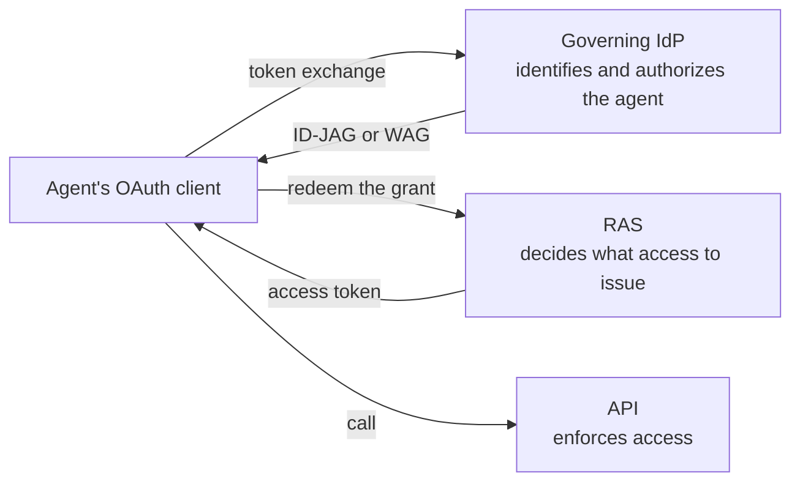

<!-- regenerate: off (set to off if you edit this file) -->

# Governed Agent Profiles

Internet-Drafts for governing agents across the platforms that run them
and the resource domains they reach. An enterprise identity provider
(IdP) resolves each agent's execution identity, its OAuth client or
workload credential, to a governed Agent Principal. Resource domains
recognize, authorize, and audit that principal without knowing the
platform. Today's common alternative, one shared OAuth client per
platform, makes every agent behind it look the same: attribution is lost
and revocation is all or nothing.

## How it works

Three parties decide. The enterprise IdP identifies the agent and
authorizes a grant naming it; the resource domain's authorization server
(RAS) decides what access to issue; and the API enforces that access
with its own checks. The agent's OAuth client carries the grant between
them. The grant depends on whom the agent acts for:

| The agent acts | Grant | The resource domain sees |
|---|---|---|
| For a user | Identity Assertion JWT Authorization Grant (ID-JAG) | The user as subject and the agent as actor |
| For itself | Workload Authorization Grant (WAG) | The agent as subject |



Companion profiles add workload inputs, gateways, SCIM administration,
lifecycle propagation, and human oversight to this path without
changing it; the architecture overview shows [how they
connect](ARCHITECTURE.md#how-they-connect).

## The drafts

Start with the [OAuth 2.0 Profile for Governed Agent Federation][core]
([source](draft-mcguinness-oauth-governed-agent-federation.md), OAuth
working group). A client, IdP, RAS, and API can implement
dedicated-client federation, one OAuth client per agent, from it alone.
The core also supports shared clients that present an existing platform
JWT identifying the agent. Add a companion when you need what it
addresses:

| When you need | Add | Working group |
|---|---|---|
| SPIFFE or Client Attestation evidence, including several managed installations behind one client | [Agent Resolution Input Profiles][inputs] ([source](draft-mcguinness-oauth-governed-agent-inputs.md)) | OAuth |
| A gateway that calls further resource domains for the agent | [Identity Continuation Profile][continuation] ([source](draft-mcguinness-oauth-governed-agent-continuation.md)) | OAuth |
| Platforms that register agents and their relationships at the IdP | [SCIM Profile for Governed Agent Federation Management][management] ([source](draft-mcguinness-scim-agent-federation.md)) | SCIM |
| OAuth client registrations managed through SCIM | [SCIM Profile for OAuth 2.0 Client Management][oauth-client] ([source](draft-mcguinness-scim-oauth-client-management.md)) | SCIM |
| Resource domains provisioned with agents and their disablement | [Governed Agent Lifecycle Profile][lifecycle] ([source](draft-mcguinness-oauth-governed-agent-lifecycle.md)) | SCIM |
| A person to approve, or to observe and end, an agent's grants, redemptions, and actions | [Human Oversight Profile][oversight] ([source](draft-mcguinness-oauth-governed-agent-oversight.md)) | OAuth |

The draft names link to the editor's copies. All seven are individual
drafts under development. An implementation that claims none of the
optional inputs needs only the core; the core and the input profiles
reference each other normatively and are published together.

## Where to start

| You are | Start with | Then |
|---|---|---|
| Evaluating the approach | The [architecture overview](ARCHITECTURE.md) | The [first transaction](EXAMPLES.md#first-delegated-transaction) of the end-to-end examples |
| An enterprise identity team | The [playbook for identity teams](PLAYBOOK.md): owners, exit checks, recipes, and runbooks | The architecture overview |
| Building an IdP, RAS, API, or client | The [implementer's guide](IMPLEMENTERS-GUIDE.md): what each role builds and configures, and the errors it returns | The core, and the [end-to-end examples](EXAMPLES.md) for the messages |
| Adding an optional capability | The guide's chapter for it: continuation for gateways and scheduled work, human oversight for approval at the IdP, the RAS, or an action, AuthZEN for policy services | The companion profile that defines it |
| Building an agent platform | The guide, then [SCIM management][management] to register agents | [Lifecycle][lifecycle] for agents the platform hosts |
| Building a SCIM service for OAuth clients | [SCIM OAuth client management][oauth-client] | |
| Testing an implementation | The [conformance suite](conformance/README.md): cases for the delegated path, deferred redemption at the RAS, and an API's policy service, each listing the control of the implementation it needs, with a test-only reference IdP, RAS, and API | |
| Tracking dependencies | The [coordination notes](COORDINATION.md): what the drafts need from the specifications they depend on | |

## Contributing

See the
[guidelines for contributions](https://github.com/mcguinness/governed-agent-profiles/blob/main/CONTRIBUTING.md).

The contributing file also has tips on how to make contributions, if you
don't already know how to do that.

## Command Line Usage

Formatted text and HTML versions of all drafts can be built using `make`.

```sh
$ make
```

Command line usage requires that you have the necessary software installed.  See
[the instructions](https://github.com/martinthomson/i-d-template/blob/main/doc/SETUP.md).

Continuous integration also runs the conformance suite with its vacuity
check, `conformance/run.py --vacuity` (setup in
[conformance/README.md](conformance/README.md)), and
`tools/check_examples.py`, which checks the messages EXAMPLES.md copies
from the drafts.

[core]: https://mcguinness.github.io/governed-agent-profiles/draft-mcguinness-oauth-governed-agent-federation.html
[inputs]: https://mcguinness.github.io/governed-agent-profiles/draft-mcguinness-oauth-governed-agent-inputs.html
[continuation]: https://mcguinness.github.io/governed-agent-profiles/draft-mcguinness-oauth-governed-agent-continuation.html
[management]: https://mcguinness.github.io/governed-agent-profiles/draft-mcguinness-scim-agent-federation.html
[lifecycle]: https://mcguinness.github.io/governed-agent-profiles/draft-mcguinness-oauth-governed-agent-lifecycle.html
[oversight]: https://mcguinness.github.io/governed-agent-profiles/draft-mcguinness-oauth-governed-agent-oversight.html
[oauth-client]: https://mcguinness.github.io/governed-agent-profiles/draft-mcguinness-scim-oauth-client-management.html
