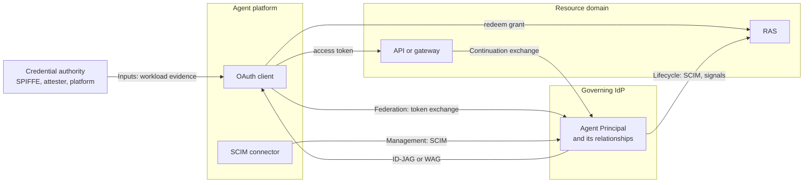

<!-- regenerate: off (set to off if you edit this file) -->

# Governed Agent Profiles

Internet-Drafts for governing agents across the platforms that run them
and the resource domains they reach. An enterprise identity provider
(IdP) resolves each agent's execution identity, its OAuth client or
workload credential, to a governed Agent Principal. Resource domains
recognize, authorize, and audit that principal without knowing the
platform. Today's common alternative, one shared OAuth client per
platform, makes every agent behind it look the same: attribution is lost
and revocation is all or nothing.

## How it works

The agent's OAuth client authenticates to the IdP and receives a grant
naming the governed agent. It exchanges that grant at the resource
domain's authorization server (RAS) for an access token. The grant
depends on whom the agent acts for:

| The agent acts | Grant | The resource domain sees |
|---|---|---|
| For a user | Identity Assertion JWT Authorization Grant (ID-JAG) | The user as subject and the agent as actor |
| For itself | Workload Authorization Grant (WAG) | The agent as subject |



The [architecture overview](ARCHITECTURE.md) explains each connection,
the principles behind it, and how revocation works across it.

## The drafts

Start with the [OAuth 2.0 Profile for Governed Agent Federation][core]
([source](draft-mcguinness-oauth-governed-agent-federation.md), OAuth
working group). A client, IdP, RAS, and API can implement
dedicated-client federation, one OAuth client per agent, from it alone.
Add a companion when you need what it addresses:

| When you need | Add | Working group |
|---|---|---|
| SPIFFE or Client Attestation evidence, including several managed installations behind one client | [Agent Resolution Input Profiles][inputs] ([source](draft-mcguinness-oauth-governed-agent-inputs.md)) | OAuth |
| A gateway that calls further resource domains for the agent | [Identity Continuation Profile][continuation] ([source](draft-mcguinness-oauth-governed-agent-continuation.md)) | OAuth |
| Platforms that register agents and their relationships at the IdP | [SCIM Profile for Governed Agent Federation Management][management] ([source](draft-mcguinness-scim-agent-federation.md)) | SCIM |
| OAuth client registrations managed through SCIM | [SCIM Profile for OAuth 2.0 Client Management][oauth-client] ([source](draft-mcguinness-scim-oauth-client-management.md)) | SCIM |
| Resource domains provisioned with agents and their disablement | [Governed Agent Lifecycle Profile][lifecycle] ([source](draft-mcguinness-oauth-governed-agent-lifecycle.md)) | SCIM |
| A person to approve, or to observe and end, an agent's grants and actions | [Human Oversight Profile][oversight] ([source](draft-mcguinness-oauth-governed-agent-oversight.md)) | OAuth |

The draft names link to the editor's copies. All seven are individual
drafts under development. The core and the input profiles reference
each other normatively and are published together; an implementation
that claims none of the optional inputs needs only the core.

## Where to start

* **[Architecture overview](ARCHITECTURE.md):** the system in one page,
  identity and responsibility, trust between parties, the delegated and
  self-acting flows and their variants, changes and failures, optional
  integrations, and a specification map with a glossary.
* **[Playbook for identity teams](PLAYBOOK.md):** five operating steps
  with exit checks, recipes for delegated and self-acting deployments,
  a vendor evidence worksheet, stop-and-restore runbooks, and an audit
  trace.
* **[Implementer's guide](IMPLEMENTERS-GUIDE.md):** message flows for
  both grants, what each role builds, configuration, and deployment
  tradeoffs.
* **[Coordination notes](COORDINATION.md):** what the drafts need from the
  specifications they depend on.

By role:

| If you build | Read |
|---|---|
| An enterprise identity program | The playbook, then the architecture overview |
| An identity provider | The core (issuance), the input profiles you support, SCIM management, and continuation if gateways continue requests |
| A resource authorization server or API | The core (redemption and resource access), and lifecycle if the domain accepts provisioning and disablement |
| An agent platform | The core (client requests), SCIM management, and lifecycle for agents the platform hosts |
| A gateway | Continuation, and the core for the access it receives |
| A SCIM service for OAuth clients | SCIM OAuth client management |

## Contributing

See the
[guidelines for contributions](https://github.com/mcguinness/governed-agent-profiles/blob/main/CONTRIBUTING.md).

The contributing file also has tips on how to make contributions, if you
don't already know how to do that.

## Command Line Usage

Formatted text and HTML versions of all drafts can be built using `make`.

```sh
$ make
```

Command line usage requires that you have the necessary software installed.  See
[the instructions](https://github.com/martinthomson/i-d-template/blob/main/doc/SETUP.md).

[core]: https://mcguinness.github.io/governed-agent-profiles/draft-mcguinness-oauth-governed-agent-federation.html
[inputs]: https://mcguinness.github.io/governed-agent-profiles/draft-mcguinness-oauth-governed-agent-inputs.html
[continuation]: https://mcguinness.github.io/governed-agent-profiles/draft-mcguinness-oauth-governed-agent-continuation.html
[management]: https://mcguinness.github.io/governed-agent-profiles/draft-mcguinness-scim-agent-federation.html
[lifecycle]: https://mcguinness.github.io/governed-agent-profiles/draft-mcguinness-oauth-governed-agent-lifecycle.html
[oversight]: https://mcguinness.github.io/governed-agent-profiles/draft-mcguinness-oauth-governed-agent-oversight.html
[oauth-client]: https://mcguinness.github.io/governed-agent-profiles/draft-mcguinness-scim-oauth-client-management.html
