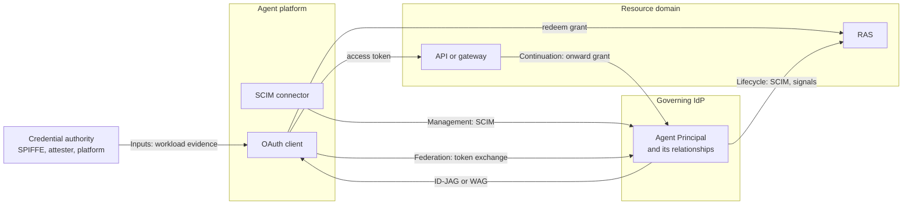

<!-- regenerate: off (set to off if you edit this file) -->

# Governed Agent Profiles

Internet-Drafts for governing agents across the platforms that run them
and the resource domains they reach. An enterprise identity provider
(IdP) resolves each agent's execution identity, its OAuth client or
workload credential, to a governed Agent Principal. Resource domains
recognize, authorize, and audit that principal without knowing the
platform. Today's common alternative, one shared OAuth client per
platform, makes every agent behind it look the same: attribution is lost
and revocation is all or nothing.



The [architecture overview](docs/overview.md) explains each connection,
the principles behind it, and how revocation works across it.

## The drafts

| Draft | Defines | Working group |
|---|---|---|
| [OAuth 2.0 Profile for Governed Agent Federation][core] ([source](draft-mcguinness-oauth-governed-agent-federation.md)) | Resolving client and workload identities to an Agent Principal, carried as the actor of an ID-JAG or the subject of a WAG | OAuth |
| [Agent Resolution Input Profiles][inputs] ([source](draft-mcguinness-oauth-governed-agent-inputs.md)) | Optional SPIFFE and Client Attestation inputs, including managed installations | OAuth |
| [Identity Continuation Profile][continuation] ([source](draft-mcguinness-oauth-governed-agent-continuation.md)) | The same Agent Principal through gateways into further resource domains | OAuth |
| [SCIM Profile for Governed Agent Federation Management][management] ([source](draft-mcguinness-scim-agent-federation.md)) | Platform-to-IdP management of Agent Principals, Identity Bindings, and Client Associations | SCIM |
| [Governed Agent Lifecycle Profile][lifecycle] ([source](draft-mcguinness-oauth-governed-agent-lifecycle.md)) | IdP-to-resource-domain provisioning, disablement, and session revocation | SCIM |
| [SCIM Profile for OAuth 2.0 Client Management][oauth-client] ([source](draft-mcguinness-scim-oauth-client-management.md)) | SCIM management of OAuth client registrations, including Client ID Metadata Document clients | SCIM |

The draft names link to the editor's copies. All six are individual
drafts under development. The federation profile and the input profiles
reference each other normatively and are published together; the others
build on the federation profile.

## Where to start

* **[Architecture overview](docs/overview.md):** the problem, principles,
  parties, how the drafts fit, revocation boundaries, platform-hosted
  agents, and related work.
* **[Implementer's guide](docs/implementers-guide.md):** message flows for
  both grants, what each role builds, configuration, and deployment
  tradeoffs.
* **[Coordination notes](COORDINATION.md):** what the drafts need from the
  specifications they depend on.

By role:

| If you build | Read |
|---|---|
| An identity provider | Federation (issuance), the input profiles you support, SCIM management, and continuation if gateways continue requests |
| A resource authorization server or API | Federation (redemption and resource access), and lifecycle if the domain accepts provisioning and disablement |
| An agent platform | Federation (client requests), SCIM management, and lifecycle for agents the platform hosts |
| A gateway | Continuation, and Federation for the access it receives |
| A SCIM service for OAuth clients | SCIM OAuth client management |

## Contributing

See the
[guidelines for contributions](https://github.com/mcguinness/governed-agent-profiles/blob/main/CONTRIBUTING.md).

The contributing file also has tips on how to make contributions, if you
don't already know how to do that.

## Command Line Usage

Formatted text and HTML versions of all drafts can be built using `make`.

```sh
$ make
```

Command line usage requires that you have the necessary software installed.  See
[the instructions](https://github.com/martinthomson/i-d-template/blob/main/doc/SETUP.md).

[core]: https://mcguinness.github.io/governed-agent-profiles/draft-mcguinness-oauth-governed-agent-federation.html
[inputs]: https://mcguinness.github.io/governed-agent-profiles/draft-mcguinness-oauth-governed-agent-inputs.html
[continuation]: https://mcguinness.github.io/governed-agent-profiles/draft-mcguinness-oauth-governed-agent-continuation.html
[management]: https://mcguinness.github.io/governed-agent-profiles/draft-mcguinness-scim-agent-federation.html
[lifecycle]: https://mcguinness.github.io/governed-agent-profiles/draft-mcguinness-oauth-governed-agent-lifecycle.html
[oauth-client]: https://mcguinness.github.io/governed-agent-profiles/draft-mcguinness-scim-oauth-client-management.html
